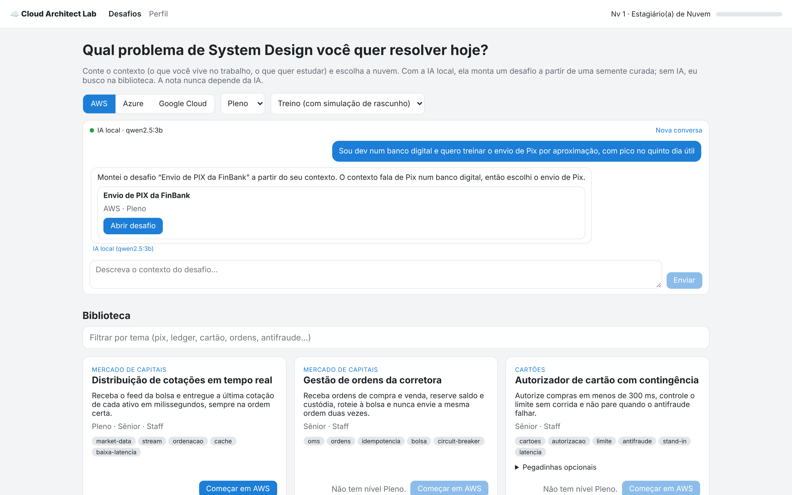
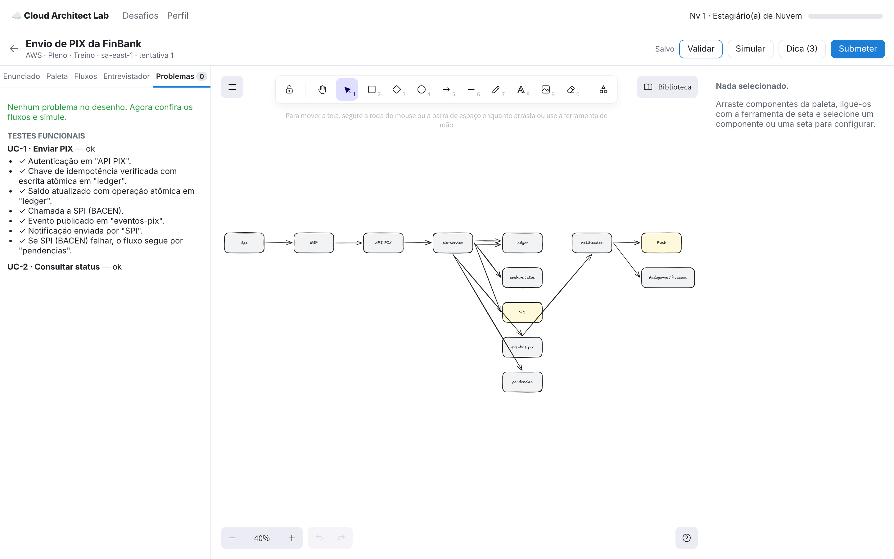
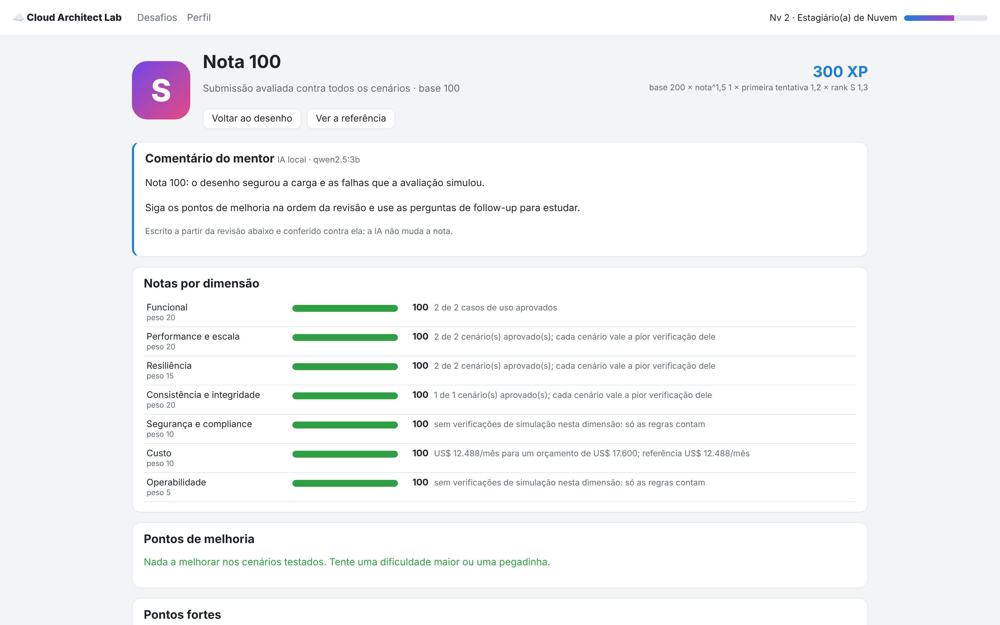

# Cloud Architect Lab

Laboratório gamificado de **System Design** para engenheiros de software do mercado financeiro.

Você conta o que quer praticar e escolhe a nuvem (AWS, Azure ou GCP). O app monta um desafio realista (PIX, ledger,
cartões, mercado de capitais, Open Finance, risco, investimentos), você desenha a solução num canvas estilo
Excalidraw com os serviços do provedor escolhido e o app **testa o desenho como se estivesse em produção**: fluxos
funcionais, carga, picos, queda de zona, sistemas externos lentos, integridade de dados (duplicidade, perda, ordem) e
custo mensal. No fim vêm a nota de 0 a 100, o rank, os pontos de melhoria com a evidência da simulação, XP e
conquistas.



| Desenho, validação e testes funcionais | Nota, XP e comentário do mentor |
|---|---|
|  |  |

- **Nota 100% determinística.** Mesmo desenho, mesma nota. Um motor de simulação de eventos discretos executa o grafo
  do seu desenho sobre um catálogo de serviços (limites, latências, autoscaling, falhas, preços).
- **IA opcional e local.** Com o [Ollama](https://ollama.com), um modelo de 3–4B na sua GPU personaliza o enunciado,
  responde como entrevistador e comenta a revisão. Sem IA, o app usa a busca guiada e as respostas curadas. Nos dois
  modos, a IA nunca mexe na nota.
- **Custo zero e privado.** Um processo .NET e um arquivo SQLite na sua máquina; nada sai dela (nem as fontes do
  canvas vêm de CDN, e uma CSP restritiva garante isso). Backup completo para exportar e importar no perfil.

## Rodar

**Requisitos:** [.NET SDK 10](https://dotnet.microsoft.com/download) (10.0.404 ou mais novo) e
[Node.js 22](https://nodejs.org) para gerar a interface. O Ollama é opcional.

```bash
cd web
npm ci
npm run build:app
```

```bash
dotnet run --project src/Lab.App -c Release
```

O app abre em <http://localhost:5080> e só escuta em `localhost`. O banco fica na pasta de dados do usuário
(`%APPDATA%\CloudArchitectLab` no Windows, `~/Library/Application Support/CloudArchitectLab` no macOS,
`~/.local/share/cloud-architect-lab` no Linux), com cópia diária (7 dias) e backup antes de cada migration.

**Executável único.** O CI publica, a cada push na `main`, o app inteiro num arquivo só (com o runtime .NET embutido)
para Windows, Linux e macOS, nos artefatos do workflow. Para gerar localmente, depois do `npm run build:app`:

```bash
dotnet publish src/Lab.App -c Release -r win-x64 --self-contained -p:PublishSingleFile=true -o publish/win-x64
```

Abrir o `Lab.App.exe` sobe o servidor e abre o navegador.

## IA local com o Ollama (opcional)

1. Instale o [Ollama](https://ollama.com/download) e baixe um modelo de 3–4B, que cabe inteiro numa GPU de 4 GB:

   ```bash
   ollama pull gemma3:4b
   ```

2. Abra o app. No modo `auto` (padrão), ele detecta o Ollama e o modelo sozinho e o chat mostra "IA local · gemma3:4b".
   Prefere respostas mais rápidas, ainda que menos cuidadosas? Baixe o `qwen2.5:3b` e use `Ai__Ollama__Model=qwen2.5:3b`.

| Papel | Sem IA | Com o Ollama |
|---|---|---|
| Contexto → desafio | Busca na biblioteca pelos termos do contexto | Escolhe a semente e devolve só um delta (narrativa, variáveis dentro das faixas, pegadinhas); o desafio é montado e validado pelo motor |
| Entrevistador | Responde com os esclarecimentos curados do desafio | Conversa livre, só com a parte pública do desafio (não conhece a referência nem os cenários ocultos) |
| Comentário do mentor | — (a revisão determinística continua lá) | Reescreve a revisão em texto corrido; só aparece se citar apenas números que estão na revisão |
| Forma desenhada à mão | Sugestão pelo nome (aliases do catálogo) | Para rótulos que o catálogo não reconhece, sugere um serviço da paleta (ou diz que é só anotação) |
| "Ajustar" o desafio | Nuvem, nível, números e pegadinhas pelos controles | Também por pedido em texto ("mais volume, com auditoria") |
| Nota, testes e revisão | Determinísticos | Determinísticos |

Configuração (`src/Lab.App/appsettings.json` ou variáveis de ambiente):

| Chave | Padrão | Exemplo por variável de ambiente |
|---|---|---|
| `Ai:Mode` | `auto` (`none` desliga, `ollama` exige) | `Ai__Mode=none` |
| `Ai:Ollama:Model` | `gemma3:4b` | `Ai__Ollama__Model=qwen2.5:3b` |
| `Ai:Ollama:Endpoint` | `http://127.0.0.1:11434` (IPv4: no Windows, `localhost` tenta o IPv6 primeiro e perde segundos) | `Ai__Ollama__Endpoint=http://127.0.0.1:11434` |
| `Ai:Ollama:ContextTokens` / `TimeoutSeconds` | `8192` / `120` | `Ai__Ollama__TimeoutSeconds=60` |
| `Ai:Ollama:ProbeTimeoutMs` | `4000` (quanto esperar o Ollama responder à checagem de disponibilidade) | `Ai__Ollama__ProbeTimeoutMs=8000` |

Os prompts são versionados em `content/prompts/<papel>/v<n>.md` e a versão usada fica gravada junto com o desafio ou a
narrativa.

**Qual modelo usar?** Compare os modelos na sua máquina com os datasets de `content/evals` (o spike S4 da spec). Com o
Ollama aberto e os modelos baixados (`ollama pull gemma3:4b`), rode na pasta do repositório. No PowerShell:

```powershell
.\lab.cmd ai eval --models "qwen2.5:3b,gemma3:4b"
```

No Linux, macOS ou Git Bash:

```bash
./lab.sh ai eval --models qwen2.5:3b,gemma3:4b
```

Referência (RTX 3050 de 4 GB, 16/11/2026): os dois modelos passam nos critérios. O `gemma3:4b` (o padrão) erra menos e
escreve em frases completas, a ≈ 19 tokens/s (≈ 2 s por resposta do entrevistador); o `qwen2.5:3b` é ≈ 4× mais rápido
(≈ 71 tokens/s, respostas em menos de 1 s), mas já trocou um número do enunciado por outro, responde seco e às vezes
corta o texto no meio. Detalhes em [docs/spec/11](docs/spec/11-estado-da-implementacao.md#spike-s4-segunda-rodada-real-16112026-1751).

Para ver se uma janela de contexto menor deixa o `gemma3:4b` mais rápido (o cache de atenção também ocupa a VRAM), rode
com `--context 4096` (o padrão do app é 8192) e compare os tokens por segundo.

O comando carrega o modelo na memória antes de medir, mostra uma linha por caso e leva alguns minutos por modelo. O
relatório (em `exports/evals/`) mostra, por modelo, deltas válidos e aderentes ao contexto, respostas certas e sem
vazamento do entrevistador, narrativas aceitas, mapeamentos certos, tempo mediano por caso, tempo até o primeiro token
e tokens por segundo, e as amostras do que a IA escreveu (para você julgar a escrita em português, que números não
mostram). Entre os modelos que passam no S4 (personalizador ≥ 80% de primeira, primeiro token ≤ 3 s, ≥ 15 tokens/s),
ele indica o mais preciso e o mais rápido, e a escolha é sua.

Falha ao falar com o Ollama (conexão, tempo esgotado) aparece como **erro** e fica fora das porcentagens; modelos com
erro ou sem a velocidade medida ganham `?` no S4 e o relatório pede para rodar de novo. Resposta errada do modelo é
reprovação (✗), nunca erro.

## Desenvolvimento

Backend e frontend com recarga (a SPA em `ng serve` usa o proxy para a API):

```bash
dotnet run --project src/Lab.App
```

```bash
cd web
npx ng serve
```

Abra <http://localhost:4200>.

### Estrutura

```text
src/
  Engine/            motor puro (sem I/O, sem relógio): Lab.Ir (IR, catálogo, desafio, compilador cena → IR),
                     Lab.Rules (regras e testes funcionais), Lab.Simulation (eventos discretos), Lab.Cost,
                     Lab.Scoring (nota, revisão, XP) e Lab.Pipeline (pipeline de avaliação e sementes)
  Lab.Content/       leitura do content/ (catálogo, sementes, textos das regras)
  Lab.Ai/            portas de IA por papel: determinístico + Ollama (Microsoft.Extensions.AI + OllamaSharp)
  Lab.Modules/       monólito modular: Profile, Challenges, Design, Evaluation, Gamification e Conversations,
                     que só se falam pelos contratos; SQLite/EF Core, jobs, outbox e SignalR
  Lab.App/           host ASP.NET Core (API, hub /hubs/lab, SPA em wwwroot)
  Lab.Cli/           CLI `lab` de autoria e validação de conteúdo
web/                 Angular 22 (zoneless, signals) com o Excalidraw como ilha React
content/             catálogo de serviços, 12 sementes de desafio, textos das regras e prompts
tests/               motor, conteúdo, IA, integração da API e arquitetura
docs/spec/           especificação
```

### Testes

```bash
dotnet test --solution CloudArchitectLab.slnx
```

```bash
cd web
npm test -- --watch=false
```

E2E com Playwright, com o app rodando em <http://localhost:5080> (as jornadas injetam a solução de referência como
desenho e conferem nota, XP, chat e entrevistador):

```bash
cd web
npm run e2e
```

A jornada com IA usa um Ollama de mentira (`web/e2e/fake-ollama.mjs`) e o cliente real do OllamaSharp. Suba o app com
`Ai__Mode=ollama Ai__Ollama__Endpoint=http://127.0.0.1:11999` e rode:

```bash
cd web
npm run e2e:ai
```

### Conteúdo e CLI `lab`

Na raiz do repositório: `./lab.sh` no Linux, macOS e Git Bash, `.\lab.cmd` no PowerShell e `lab` no Prompt de
Comando. No PowerShell, ponha listas com vírgula entre aspas (`--models "a,b"`); sem aspas ele separa os itens, o
que o `lab` também aceita.

```bash
./lab.sh challenge list
./lab.sh challenge validate --quick
./lab.sh challenge show pix/envio-pix --difficulty senior --provider gcp
./lab.sh evaluate pix/envio-pix --reference --difficulty senior
./lab.sh rules validate
./lab.sh catalog validate
./lab.sh ai eval --models qwen2.5:3b,gemma3:4b
```

`challenge validate` sem `--quick` roda a solução de referência de cada semente nas três nuvens, nos cantos das faixas
de variação e com cada pegadinha, e exige nota 85 ou mais.

### Skills do Claude Code

O conteúdo é escrito com o Claude Code no próprio repositório (uso normal do plano, sem custo extra). As skills em
`.claude/skills/` guiam o trabalho:

| Skill | Para quê |
|---|---|
| `novo-desafio` | Criar ou corrigir uma semente em `content/challenges/` e iterar com o validador até passar |
| `calibrar-catalogo` | Ajustar limites, latências e preços do catálogo com a documentação oficial, registrando fonte e data |
| `revisar-avaliacao` | Escrever uma revisão aprofundada de uma avaliação exportada (`exports/<id>/`) |

### CI

O GitHub Actions (`.github/workflows/ci.yml`) roda build com warnings como erro, `dotnet format`, todos os testes,
validação de conteúdo (`rules`, `catalog` e `challenge validate --quick`), pacotes vulneráveis, Vitest, build e
auditoria do frontend, as jornadas E2E nos modos sem IA e com o Ollama simulado e o `lab ai eval` contra esse mesmo
Ollama simulado. Na `main`, publica os executáveis.
O CI nunca chama um modelo de verdade.

## Documentação

- [Especificação](docs/spec/README.md): produto, requisitos, arquitetura, canvas e IR, motor de avaliação, IA,
  gamificação, dados e API, qualidade e roadmap.
- [Estado da implementação](docs/spec/11-estado-da-implementacao.md): o que já existe, o que mudou em relação à
  spec e o que falta.
