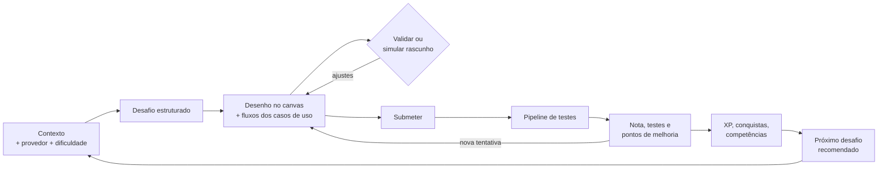

# 01 — Visão e produto

## Problema

Estudar System Design costuma ser passivo: livros, vídeos, diagramas de referência. Falta o que fixa o aprendizado: **praticar com feedback objetivo e rápido**. Numa entrevista ou num design review de verdade, ninguém pergunta se o diagrama está bonito. As perguntas são outras: "e com 10x de tráfego?", "e se a AZ cair?", "esse PIX pode ser debitado duas vezes?", "quanto isso custa por mês?". O Cloud Architect Lab faz essas perguntas para cada solução desenhada e mede as respostas.

## Persona

**Engenheiro(a) de software no mercado financeiro**, pleno ou sênior, que:

- quer evoluir para sênior, staff ou arquiteto(a) e se preparar para entrevistas de System Design;
- lida com os requisitos típicos do setor: consistência de saldo, idempotência, trilha de auditoria, janelas de liquidação, baixa latência, dependências externas (SPI, bandeiras, B3), regulação (BACEN, LGPD, PCI DSS) e residência de dados no Brasil;
- quer saber resolver o mesmo problema em AWS, Azure e GCP;
- não quer pagar nada além do que já paga (plano Pro do Claude).

## Objetivos

| Objetivo | Como medir no próprio app |
|---|---|
| Prática frequente | ≥ 3 desafios avaliados por semana; streak |
| Evolução mensurável | Rating por competência subindo ao longo de 8 semanas |
| Cobertura ampla | Todas as competências com ≥ 3 avaliações |
| Fluência multi-cloud | Mesmo desafio resolvido em ≥ 2 provedores |
| Feedback confiável | Ressubmeter o mesmo desenho produz exatamente a mesma nota |
| Custo zero | Nenhuma cobrança recorrente para usar o app |

## Fora de escopo na v1

- Ferramenta de diagramação profissional ou substituto do Excalidraw/draw.io para documentação.
- Provisionar infraestrutura real em nuvem. O modo Sandbox (Fase 4) usa emuladores locais, nunca a sua conta de nuvem.
- Multiusuário, ranking público ou recursos sociais.
- Gêmeo digital certificado da nuvem: a simulação é **educacional e calibrada**, com premissas explícitas e versionadas.
- Aconselhamento regulatório: as regras de compliance são didáticas.

## Loop principal



## Jornada do MVP

1. **Home.** Nível, XP, streak, radar de competências, desafios recomendados e "Continuar tentativa".
2. **Novo desafio.** Você escreve o contexto em linguagem livre e escolhe, logo acima da caixa de texto, **Provedor** (`AWS · Azure · GCP · Genérico`), **Dificuldade** (Júnior, Pleno, Sênior, Staff ou Automática) e **Modo**. O que acontece em seguida depende do modo de IA configurado (ver [06 — IA](06-ia.md)):
   - *Sem IA (sempre disponível):* o app busca na biblioteca de desafios-semente (por domínio, tags e texto) e propõe os 3 mais aderentes, já ajustados ao provedor e à dificuldade por variação procedural: volumetria, SLOs, restrições e "pegadinhas" como conta quente ou SPI degradado.
   - *IA local (Ollama, o padrão na sua máquina) ou Claude API:* a IA faz até 2 perguntas de calibração e personaliza uma semente para o seu contexto (narrativa, números, restrições). O resultado sempre passa pela validação do motor antes de aparecer.
   - *Ponte com o claude.ai (opcional, Fase 2):* o app gera um prompt pronto; você cola no claude.ai, cola a resposta de volta e o app valida.
3. **Cartão do desafio.** Título, narrativa, casos de uso (UC-1…n), SLOs, volumetria, restrições (regulatórias, orçamento, região), competências avaliadas, número de cenários ocultos e recompensa de XP. Ações: **Aceitar**, **Outro**, **Ajustar** (ex.: "menos volumetria", "foco em resiliência").
4. **Workspace.** Canvas com a paleta do provedor, inspector de propriedades, painel de problemas (validação ao vivo) e painel do entrevistador (esclarecimentos e dicas com custo de XP).
5. **Fluxos.** Para cada caso de uso, você define o caminho da requisição clicando nas setas em ordem, ou aceita a sugestão automática. O canvas mostra a sequência numerada.
6. **Validar** (instantâneo, gratuito): validação estrutural + regras. **Simular rascunho** (só no modo Treino): roda os cenários públicos de carga, sem nota.
7. **Submeter.** Congela um snapshot e inicia o pipeline; uma tela de progresso mostra cada etapa em tempo real. Os **cenários ocultos** (caos e integridade) só rodam aqui, como os testes ocultos de uma maratona de programação, sempre derivados de requisitos declarados no enunciado.
8. **Resultado.** Nota (0–100) e rank, radar por dimensão, lista de testes (✓/✗ com o motivo), gráficos (latência p50/p95/p99, vazão, erros, backlog de filas), linha do tempo do caos, custo mensal estimado, pontos de melhoria clicáveis, **replay** da simulação sobre o canvas (Fase 2), solução de referência e XP/conquistas ganhos.
9. **Depois.** "Nova tentativa" (mantém o desenho), "Resolver em outra nuvem" ou "Próximo desafio" (recomendado).

## Botão de provedor

| A escolha muda… | Exemplo |
|---|---|
| A paleta do canvas | AWS: API Gateway, Lambda, SQS, DynamoDB… · Azure: API Management, Functions, Service Bus, Cosmos DB… · GCP: Apigee, Cloud Run, Pub/Sub, Spanner… |
| O catálogo de simulação | Limites, latências, escalabilidade e modos de falha de cada serviço |
| Os preços | Tabela de preços do provedor e da região (versionada) |
| O desafio | Restrições e solução de referência do provedor (ex.: região `sa-east-1`, Brazil South ou `southamerica-east1`) |
| O feedback | Textos e links do framework do provedor (AWS Well-Architected, Azure Well-Architected, Google Cloud Well-Architected) |

- O provedor é definido ao criar a tentativa. Trocar depois cria **outra tentativa no mesmo desafio** ("Resolver em outra nuvem"), que conta para a conquista *Poliglota de Nuvem*.
- **Genérico** usa os arquétipos sem marca (Fila, Banco relacional, Cache…), bom para treinar entrevistas agnósticas de nuvem.

## Modos de jogo

| Modo | Regras | Para quê |
|---|---|---|
| **Treino** | Sem tempo; dicas disponíveis (custam XP); simulação de rascunho ilimitada | Aprender um tema |
| **Entrevista** (Fase 3) | 45 min; sem simulação de rascunho nem regras ao vivo; 1 submissão; perguntas de follow-up ao final | Preparação para entrevista |
| **Plantão** (Fase 3) | Você recebe uma arquitetura pronta que falha num cenário (ex.: fila acumulando no dia de pagamento) e tem 30 min para diagnosticar e corrigir | Troubleshooting e trade-offs |
| **Desafio diário** (Fase 3) | Um desafio por dia, sorteado de forma determinística a partir da data | Hábito e streak |
| **Trilha** (Fase 2) | Sequência temática de 5–7 desafios com um "chefão" no final | Aprofundar um domínio |

### Assistências por modo

| Assistência | Treino | Entrevista | Plantão |
|---|---|---|---|
| Validação estrutural (setas soltas, configuração inválida) | ✓ | ✓ | ✓ |
| Regras de arquitetura ao vivo | ✓ | — | ✓ |
| Capacidade estimada ao vivo (Fase 2) | ✓ | — | — |
| Sugestão de fluxos | ✓ | — | ✓ |
| Simulação de rascunho (cenários públicos) | ✓ ilimitada | — | ✓ até 3 |
| Dicas (custam XP) | ✓ | — | ✓ |
| Mapeamento assistido de rótulos | ✓ | ✓ | ✓ |

## Telas

Wireframes de baixa fidelidade, só para fixar conteúdo e hierarquia.

### Novo desafio

```
┌──────────────────────────────────────────────────────────────────────────┐
│ Cloud Architect Lab                    Nível 7 · Pleno II  ▓▓▓▓▓▓░░ 62%  │
├──────────────────────────────────────────────────────────────────────────┤
│ Você  Trabalho numa corretora. Quero desenhar a distribuição de cotações │
│       da B3 para 200 mil clientes em tempo real.                         │
│                                                                          │
│ Lab   Foco em latência (p99 < 50 ms) ou em escala de conexões? Inclui    │
│       histórico intradiário?                                             │
│                                                                          │
│ ┌ Ticker em tempo real da Corretora Ípsilon ────────────────────────┐   │
│ │ UC-1 Assinar ativos · UC-2 Receber cotações · UC-3 Histórico do dia│   │
│ │ Entrega p99 < 150 ms · 200 mil conexões · pico 50 mil msg/s        │   │
│ │ Orçamento US$ 6.000/mês · dados no Brasil · 3 cenários ocultos     │   │
│ │ Competências: baixa latência, mensageria, escalabilidade · +450 XP │   │
│ │ [Aceitar]  [Outro]  [Ajustar]                                      │   │
│ └────────────────────────────────────────────────────────────────────┘   │
├──────────────────────────────────────────────────────────────────────────┤
│ Provedor [ AWS | Azure | GCP | Genérico ]   Dificuldade [Sênior v]       │
│ Modo [Treino v]                                    IA: local (Ollama)    │
│ ┌────────────────────────────────────────────────────────────┐ [Enviar]  │
│ │ Descreva o contexto...                                     │           │
│ └────────────────────────────────────────────────────────────┘           │
└──────────────────────────────────────────────────────────────────────────┘
```

### Workspace

```
┌─────────────┬────────────────────────────────────────────┬──────────────┐
│ DESAFIO     │ AWS · Treino     [Validar] [Simular] [Submeter] PROPRIEDADES│
│ Enunciado   │                                            │ SQS FIFO     │
│ Requisitos  │  ┌──────┐   ┌───────────┐   ┌──────────┐   │ nome: ordens │
│ Restrições  │  │Client│──▶│API Gateway│──▶│  Lambda  │   │ DLQ: sim     │
│─────────────│  └──────┘   └───────────┘   └────┬─────┘   │ tentativas: 5│
│ PALETA      │                                  ┆ async   │ alta vazão:  │
│ [buscar]    │                ┌──────────┐      ▼         │   sim        │
│ Borda/Rede  │                │ DynamoDB │◀─┌──────────┐  │ ──────────── │
│ Computação  │                └──────────┘  │ SQS FIFO │  │ Operação     │
│ Dados       │                              └──────────┘  │ métricas: sim│
│ Mensageria  │                                            │ alarme de    │
│ Segurança   │                                            │ backlog: não │
│ Externos    │                                            │              │
├─────────────┴────────────────────────────────────────────┴──────────────┤
│ PROBLEMAS (3)   FLUXOS   ENTREVISTADOR                                  │
│ !  ARQ-004  Fila "ordens" sem DLQ configurada              [Ir] [Ver]   │
│ !  IR-004   "Redis" não tipado → mapear para ElastiCache?  [Aplicar]    │
│ x  FLX-001  UC-3 não tem caminho até um armazenamento      [Ir]         │
└─────────────────────────────────────────────────────────────────────────┘
```

### Resultado

```
┌──────────────────────────────────────────────────────────────────────────┐
│  Nota 78 · Rank B                 +289 XP     Conquista: Zero Duplicidade │
├────────────────────────┬─────────────────────────────────────────────────┤
│  Funcional       92    │ ✓ UC-1 fluxo completo e capacidades atendidas   │
│  Performance     71    │ ✓ Baseline: p99 118 ms (SLO 150 ms)             │
│  Resiliência     64    │ ✗ Pico 5x: p99 410 ms; gargalo na Lambda        │
│  Consistência    95    │   (concorrência necessária 3.400; limite 1.000) │
│  Segurança       80    │ ✗ Queda de AZ: 3,2% de erros por 95 s           │
│  Custo           70    │ ✓ Duplicidade: 0 efeitos duplicados             │
│  Operação        60    │ Custo: US$ 4.870/mês (orçamento US$ 6.000)      │
├────────────────────────┴─────────────────────────────────────────────────┤
│ Pontos de melhoria                                                       │
│ 1. [Alta] Concorrência da Lambda "ingestor" estoura no pico: concorrência │
│    provisionada ou contêineres com autoscaling                    [ver]  │
│ 2. [Média] ElastiCache sem réplica em outra AZ (ponto único de falha) [ver]│
│ [Replay]  [Solução de referência]  [Nova tentativa]  [Outra nuvem]       │
└──────────────────────────────────────────────────────────────────────────┘
```

### Perfil e progresso

```
┌──────────────────────────────────────────────────────────────────────────┐
│ Nível 7 · Pleno II        3.420 / 4.000 XP           Streak: 12 dias     │
├─────────────────────────────────┬────────────────────────────────────────┤
│ Competências                    │ Histórico                              │
│  Escalabilidade        ▓▓▓▓▓░ 71│  14/11 PIX com conta quente  AWS   B 78│
│  Resiliência           ▓▓▓▓░░ 64│  12/11 Ledger partidas dobr. GCP   A 86│
│  Consistência de dados ▓▓▓▓▓▓ 88│  10/11 Ticker de cotações    Azure C 63│
│  Mensageria e eventos  ▓▓▓▓▓░ 75│                                        │
│  Baixa latência        ▓▓▓░░░ 52│ Recomendados                           │
│  Segurança/compliance  ▓▓▓▓░░ 66│  > Antifraude em streaming (Resiliênc.)│
│  Custo (FinOps)        ▓▓▓▓░░ 60│  > Cotações com conflation (Latência)  │
│  Observabilidade       ▓▓▓░░░ 48│                                        │
├─────────────────────────────────┴────────────────────────────────────────┤
│ Conquistas: Primeiro Deploy · Zero Duplicidade · AZ? Que AZ?   (8 de 25) │
└──────────────────────────────────────────────────────────────────────────┘
```
