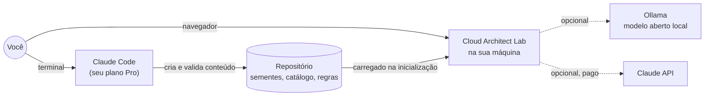
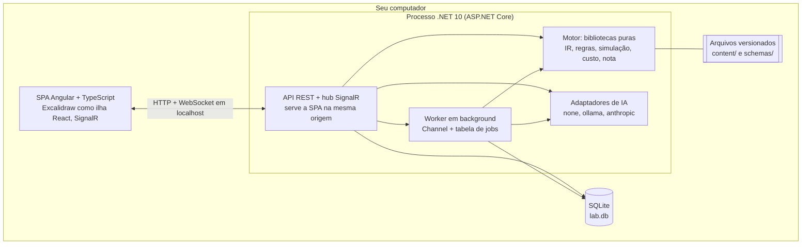
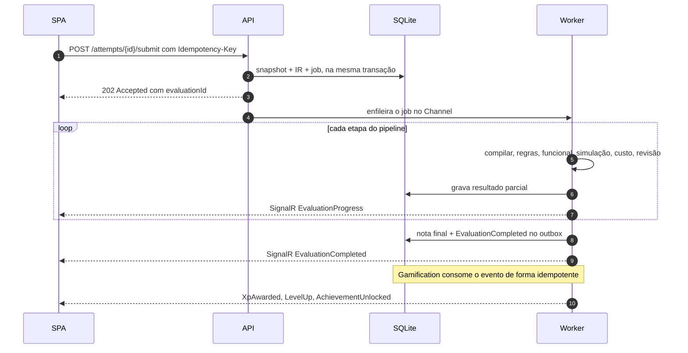

# 03 — Arquitetura

## Princípios

1. **Custo zero por padrão.** Nada no caminho padrão depende de serviço pago; todo custo é opt-in explícito.
2. **Local-first.** Um processo .NET e um arquivo SQLite na sua máquina. Docker não é obrigatório.
3. **Determinismo onde vale nota.** Compilação, regras, simulação, custo e nota são funções puras e reprodutíveis.
4. **IA onde agrega, sempre opcional.** Conteúdo de alta qualidade é criado em tempo de autoria com o Claude Code; em execução, adaptadores plugáveis.
5. **Dados em vez de código.** Serviços de nuvem, preços, sementes, textos das regras e prompts são arquivos versionados.
6. **Fronteiras explícitas.** Monólito modular com contratos entre módulos verificados por testes.

Ironia saudável: o app ensina System Design, então ele próprio precisa ser um bom exemplo. Um monólito modular local é a resposta certa para um usuário e um desenvolvedor — e pode virar um desafio da biblioteca ("evolua o Cloud Architect Lab para 10 mil usuários").

## Contexto



## Processo e componentes



**Por que um processo só:** um usuário não justifica dois processos. A simulação (CPU) roda em threads dedicadas, com paralelismo limitado a `núcleos − 1` para não travar a interface. Se um dia o app tiver muitos usuários, separar o worker é trocar o `Channel` por uma fila real — os módulos já se comunicam por contratos e eventos.

## Módulos

| Módulo | Responsabilidade | Principais entidades | Publica |
|---|---|---|---|
| Profile | Perfil local e preferências (provedor padrão, domínios, idioma) | Profile | — |
| Conversations | Conversas de novo desafio e do entrevistador; streaming | Conversation, Message | — |
| Challenges | Biblioteca de sementes, busca, variação procedural, personalização por IA, ponte manual, recomendação | Challenge | ChallengeCreated |
| Design | Tentativas, rascunhos, snapshots, compilação cena → IR, fluxos | Attempt, DiagramSnapshot | AttemptSubmitted |
| Evaluation | Pipeline, achados, cenários, custo, revisão, nota | Evaluation, Finding, ScenarioResult | EvaluationCompleted |
| Gamification | Ledger de XP, níveis, competências, conquistas, streak, trilhas | XpEntry, UserAchievement, CompetencyRating | XpAwarded, LevelUp, AchievementUnlocked |

Bibliotecas compartilhadas, sem estado próprio:

- **Engine** (`Lab.Ir`, `Lab.Rules`, `Lab.Simulation`, `Lab.Cost`, `Lab.Scoring`): funções puras — sem I/O, sem relógio do sistema, sem aleatoriedade global.
- **Content** (`Lab.Content`): carrega e valida catálogo, sementes, textos das regras e prompts.
- **AI** (`Lab.Ai`): portas por papel e adaptadores (ver [06 — IA](06-ia.md)).

### Comunicação entre módulos

- **Síncrona:** só pelas interfaces e DTOs do projeto `Contracts` de cada módulo (em processo).
- **Assíncrona:** eventos de domínio gravados numa tabela `outbox` **na mesma transação** da mudança e despachados em processo. Entrega pelo menos uma vez; consumidores idempotentes. Exemplo: `EvaluationCompleted` → Gamification credita XP com chave única `(perfil, motivo, evaluationId)`.
- Sem MediatR: handlers explícitos registrados na injeção de dependência.

## Estrutura da solução

```
CloudArchitectLab.sln
├─ src/
│  ├─ Lab.App/                  # host único: endpoints, SignalR, worker, serve a SPA
│  ├─ Lab.AppHost/              # opcional: Aspire (app + ng serve + Ollama + dashboard OTel)
│  ├─ Modules/
│  │  ├─ Lab.Profile/
│  │  ├─ Lab.Conversations/
│  │  ├─ Lab.Challenges/
│  │  ├─ Lab.Design/
│  │  ├─ Lab.Evaluation/
│  │  └─ Lab.Gamification/      # cada um: Domain/ Application/ Infrastructure/ Endpoints/ Contracts/
│  ├─ Engine/
│  │  ├─ Lab.Ir/                # modelo IR + compilador cena → IR
│  │  ├─ Lab.Rules/             # regras de arquitetura, dados, segurança e operação
│  │  ├─ Lab.Simulation/        # modelo analítico + eventos discretos
│  │  ├─ Lab.Cost/              # custo mensal
│  │  └─ Lab.Scoring/           # dimensões, travas, rank, XP
│  ├─ Lab.Content/              # loaders + validação de conteúdo
│  ├─ Lab.Ai/                   # portas + adaptadores none / ollama / anthropic
│  └─ Lab.Cli/                  # ferramenta `lab` (validar conteúdo, rodar referência, exportar)
├─ content/
│  ├─ catalog/                  # archetypes.yaml, aws/, azure/, gcp/, generic/, pricing/
│  ├─ challenges/               # sementes por trilha (pix/, ledger/, cartoes/, mercado-capitais/…)
│  ├─ rules/                    # por quê, como corrigir, trade-offs, follow-ups e links de cada regra
│  └─ prompts/                  # prompts versionados dos modos com IA
├─ schemas/                     # JSON Schemas: challenge, catalog, rule, ir, review
├─ web/                         # SPA Angular (Angular CLI)
├─ .claude/skills/              # skills do Claude Code para autoria (ver 06)
├─ tests/                       # ver 09
└─ docs/spec/
```

## Stack

| Camada | Escolha | Observações |
|---|---|---|
| Runtime | .NET 10 LTS, C# 14 | Suporte até nov/2028; .NET 11 (STS) não traz nada essencial aqui |
| Web | ASP.NET Core Minimal APIs, OpenAPI nativo, validação nativa de Minimal APIs | Erros em ProblemDetails (RFC 9457) |
| Tempo real | SignalR | Streaming do chat, progresso do pipeline, eventos de XP |
| Persistência | EF Core 10 + SQLite | Colunas JSON para cena, IR e resultados; BLOB comprimido para séries; FTS5 para busca |
| Jobs | `Channel<T>` + `BackgroundService` + tabela `jobs` | Retomada após reinício; etapas idempotentes |
| Conteúdo | YAML (YamlDotNet) validado por JSON Schema (JsonSchema.Net) | Recarregável em desenvolvimento |
| IA local | `IChatClient` (Microsoft.Extensions.AI) implementado pelo OllamaSharp | Saída estruturada por JSON Schema |
| IA paga (opt-in) | SDK oficial `Anthropic` (NuGet) | Ver [06 — IA](06-ia.md) |
| Frontend | Angular (versão atual): componentes standalone, signals, detecção de mudanças zoneless, Angular CLI | Sua escolha ([ADR-002](#adr-002--angular-com-o-excalidraw-como-ilha-react)) |
| UI | Angular Material + CDK; Tailwind CSS para layout | CDK também para arrastar da paleta e para painéis redimensionáveis |
| Estado | Signals + serviços; NgRx SignalStore no workspace | Rascunho, seleção, diagnósticos e fluxos |
| Canvas | `@excalidraw/excalidraw` (MIT) como ilha React dentro de um componente Angular | Carregado sob demanda; assets servidos localmente (`EXCALIDRAW_ASSET_PATH`), sem CDN externa; ver [04](04-canvas-catalogo-e-ir.md#integração-com-o-angular) |
| Inspector | ngx-formly com suporte a JSON Schema | Formulários gerados do `configSchema` do catálogo |
| Gráficos | Apache ECharts via ngx-echarts | Séries densas e replay |
| Chat | ngx-markdown, com sanitização | Respostas do entrevistador e textos curados |
| Cliente tempo real | `@microsoft/signalr` num serviço Angular | Eventos expostos como signals |
| Cliente da API | Serviços e modelos gerados do OpenAPI (ng-openapi-gen) | Frontend sem regra de negócio que vale nota |
| Observabilidade | OpenTelemetry; Aspire Dashboard opcional em desenvolvimento | |
| Testes | xUnit v3, Shouldly, Verify, CsCheck, ArchUnitNET, Vitest (Angular CLI) + Angular Testing Library, Playwright | Ver [09](09-qualidade-seguranca-operacao.md) |
| Empacotamento | `dotnet publish` como executável único (Windows, macOS, Linux) com a SPA embutida | |
| CI | GitHub Actions dentro da cota gratuita | |

### Cuidados com licenças

| Evitar | Motivo | Usar |
|---|---|---|
| MediatR, AutoMapper | Passaram a licença comercial em 2025 | Handlers explícitos; mapeamento manual ou Mapperly |
| MassTransit v9 | Licença comercial | Outbox próprio (é pequeno) |
| FluentAssertions v8 | Licença comercial para uso comercial | Shouldly ou AwesomeAssertions |
| tldraw | Licença própria; produção exige chave | Excalidraw (MIT) |
| Ícones oficiais de AWS/Azure/GCP | Liberados para diagramas, cada provedor com seus termos | Uso pessoal ok; revisar os termos antes de publicar o app |

## Fluxo de submissão



## Execução e hospedagem

### Modo padrão: local, só no desktop

- **No uso do dia a dia:** o executável único sobe o servidor e abre o navegador padrão em `http://localhost:5080`.
- **Em desenvolvimento:** `dotnet run --project src/Lab.App` para o backend e `ng serve` para o Angular, com `proxy.conf.json` encaminhando `/api` e `/hubs` (WebSocket) para o backend — ou os dois juntos pelo `Lab.AppHost` (Aspire). No build de produção, `ng build` gera os arquivos estáticos que o app .NET serve, com fallback para `index.html`.
- Escuta só em `127.0.0.1`; sem login. As proteções do localhost (validação do `Host` contra DNS rebinding, header próprio contra CSRF) estão em [09](09-qualidade-seguranca-operacao.md#segurança).
- Dados numa pasta do usuário (ex.: `%APPDATA%\CloudArchitectLab\` no Windows, `~/.local/share/cloud-architect-lab/` no Linux). Backup diário automático com 7 cópias; exportação/importação em JSON.
- Se o Ollama estiver rodando com o modelo configurado, o modo `auto` liga o chat com IA local.

### Acesso remoto: fora do escopo por enquanto

Decisão de 15/11/2026: uso só no desktop. Se um dia você quiser abrir pelo celular, o caminho gratuito já está mapeado: Cloudflare Tunnel (publica o app local sem abrir portas no roteador) + Cloudflare Access (login na frente), ambos sem custo, mais um domínio de ~US$ 10/ano para ter endereço fixo. O app ganharia um `RemoteMode` que só aceita requisições com o JWT do Access. *Quick tunnels* (`*.trycloudflare.com`) não servem: são temporários e não têm Access.

### Por que o backend não roda no Cloudflare gratuito

| Opção | Para um backend .NET | Custo |
|---|---|---|
| Cloudflare Workers | Executam JavaScript/TypeScript, Python e WebAssembly; não executam ASP.NET Core | Grátis, mas não serve |
| Cloudflare Containers | Executam a imagem .NET, mas exigem o plano Workers Paid | A partir de US$ 5/mês |
| Cloudflare Pages | Hospeda só frontend estático | Grátis |
| Free tiers de Cloud Run ou Azure Container Apps + PostgreSQL gratuito (ex.: Neon) | Funcionam, mas exigem cartão de crédito e cobram acima da cota | ~0, com risco de cobrança |

> Planos e preços do Cloudflare mudam: confirme na documentação oficial antes de decidir. Esta tabela reflete o cenário conhecido em 2026 e não foi conferida no site do Cloudflare durante a escrita desta spec.

### Futuro: versão 100% estática no Cloudflare Pages (Fase 5)

Como o motor é C# puro, ele pode ser compilado para WebAssembly (`browser-wasm`, exportando funções com `[JSExport]`) e rodar num Web Worker do navegador. Com o conteúdo embutido no bundle e os dados no IndexedDB, o app inteiro vira arquivos estáticos no Cloudflare Pages: grátis, sem servidor, acessível de qualquer lugar em `*.pages.dev`, sem túnel nem domínio.

Custos dessa opção: download do runtime .NET (alguns MB, depois em cache), simulação mais lenta (exige compilação AOT para WebAssembly e janelas de simulação menores), dados presos a um navegador (resolvido com exportação/importação) e IA em execução limitada (Ollama só funciona na mesma máquina). Ver [ADR-010](#adr-010--motor-puro-e-compatível-com-webassembly) e o spike S5.

## Decisões de arquitetura (ADRs)

### ADR-001 — Monólito modular em processo único

- **Contexto:** um usuário, uma máquina, custo zero, um desenvolvedor.
- **Decisão:** um processo ASP.NET Core com API, hub SignalR, worker em background e o motor; módulos com contratos explícitos.
- **Alternativas:** API e worker em processos separados (útil com muitos usuários; aqui só adiciona operação); microsserviços.
- **Consequências:** `dotnet run` e pronto; testes de arquitetura garantem as fronteiras; separar o worker no futuro é localizado.

### ADR-002 — Angular, com o Excalidraw como ilha React

- **Contexto:** você escolheu Angular (15/11/2026). A tela principal é um canvas estilo Excalidraw, e o Excalidraw é um componente React; o resto do app (chat, painéis, resultados, gamificação) é natural em Angular.
- **Decisão:** Angular (standalone, signals, zoneless) no app inteiro; o Excalidraw roda como uma "ilha" React montada por um único componente Angular, atrás de um adaptador tipado (`CanvasAdapter`). Detalhes em [04](04-canvas-catalogo-e-ir.md#integração-com-o-angular).
- **Alternativas:** (a) React no app inteiro: integração direta com o Excalidraw, mas não é a stack escolhida; (b) Blazor com o Excalidraw via interop JS: duas linguagens no navegador e interop a cada evento do canvas; (c) um editor de diagramas agnóstico (JointJS, draw.io embutido): perderia a experiência de desenho livre pedida.
- **Consequências:** React e ReactDOM entram só no chunk do workspace, carregado sob demanda; nenhuma outra parte do app conhece o Excalidraw; trocar de canvas no futuro é reimplementar o adaptador. Toda regra que vale nota continua no backend.

### ADR-003 — Canvas semântico com Excalidraw

- **Contexto:** a avaliação exige um grafo tipado; o usuário quer a liberdade do Excalidraw.
- **Decisão:** a cena do Excalidraw é a fonte visual; componentes da paleta carregam `customData`; setas vinculadas viram arestas; frames viram fronteiras; o resto vira anotação; formas não tipadas recebem sugestão de mapeamento. Detalhes em [04](04-canvas-catalogo-e-ir.md).
- **Alternativas:** React Flow (xyflow, MIT): grafo nativo, mas com cara de editor de nós, não de quadro branco; tldraw: ótimo SDK, licença com chave para produção; interpretar uma imagem do desenho com IA: não determinístico.
- **Consequências:** exige um compilador cena → IR com testes de snapshot; versão do Excalidraw fixada atrás de um adaptador.

### ADR-004 — Avaliação determinística; IA nunca altera a nota

- **Contexto:** "testar como se tivesse uso real", com nota justa, reprodutível e sem custo.
- **Decisão:** motor próprio (modelo analítico + simulação de eventos discretos) sobre um catálogo calibrado; regras como código; revisão determinística montada a partir de textos curados; IA opcional só para narrativa.
- **Alternativas:** só LLM (não reprodutível, alucina, custa); infraestrutura real na nuvem (custo, lentidão, risco, e o desenho não tem código de aplicação); emuladores locais (viram o modo Sandbox, Fase 4).
- **Consequências:** o motor é o maior investimento técnico do projeto. A fidelidade depende do catálogo, então as premissas são explícitas, versionadas e exibidas no resultado.

### ADR-005 — IR agnóstica de provedor + catálogo como dados

- **Decisão:** cada serviço mapeia para um arquétipo (fila, stream, chave-valor, relacional…); motor e regras trabalham sobre arquétipos + parâmetros do catálogo.
- **Consequências:** novo serviço ou provedor = YAML. Diferenças reais entre serviços (ex.: SQS FIFO × sessões do Service Bus) viram parâmetros e capacidades, não código.

### ADR-006 — SQLite local

- **Decisão:** EF Core 10 + SQLite em um arquivo; colunas JSON para cena, IR e resultados; séries temporais comprimidas em BLOB; FTS5 para busca na biblioteca.
- **Alternativas:** PostgreSQL (melhor para nuvem e multiusuário; exige Docker ou um serviço); LiteDB.
- **Consequências:** zero instalação, backup = copiar o arquivo. Se o app for para a nuvem, migrar para PostgreSQL com migrations próprias.

### ADR-007 — IA plugável com custo zero; Claude Code para autoria

- **Contexto:** requisito de custo zero; o plano Pro não pode ser backend de aplicação (ver [06](06-ia.md)).
- **Decisão:** (a) sementes, soluções de referência, dicas e textos das regras são criados em tempo de autoria com o Claude Code e validados pelo motor; (b) em execução, portas por papel com adaptadores `none` (padrão), `ollama` (local, grátis) e `anthropic` (Claude API, opt-in com teto de gasto).
- **Alternativas:** Claude API como padrão (melhor qualidade, ~US$ 9/mês estimados); free tiers de outras APIs de LLM (limites e termos variáveis); automatizar o Claude Code ou a assinatura a partir do backend (não é o caminho suportado pela Anthropic — descartado).
- **Consequências:** o app nunca depende de IA para funcionar; a qualidade da conversa em execução depende do modelo local disponível.

### ADR-008 — Fila em processo, persistida

- **Decisão:** `Channel<T>` + `BackgroundService`; tabela `jobs` no SQLite para retomar após reinício; resultados de etapa gravados por `(evaluationId, etapa)`, então reexecutar é seguro.
- **Alternativas:** Hangfire (storage e dashboard próprios), Quartz.NET, broker externo.

### ADR-009 — Local-first, só no desktop

- **Decisão:** o app roda na sua máquina e é usado só nela (15/11/2026). Sem túnel, sem domínio, sem nuvem.
- **Alternativas:** Cloudflare Tunnel + Access (grátis, mas exige domínio para endereço fixo; fica mapeado para o futuro); Tailscale (grátis, exige cliente em cada dispositivo); nuvem com free tier (exige cartão, risco de cobrança); Cloudflare Containers (plano pago).
- **Consequências:** custo zero absoluto e nenhum dado sai da máquina sem opt-in; abrir pelo celular exigirá uma decisão futura.

### ADR-010 — Motor puro e compatível com WebAssembly

- **Decisão:** bibliotecas do motor sem I/O, sem relógio do sistema, sem `Random` global e sem reflection dinâmica (amigáveis a trimming e AOT); a partir da Fase 2, o CI também executa os testes do motor em `browser-wasm`.
- **Motivo:** mantém aberta a versão estática gratuita no Cloudflare Pages e permite validar desenhos no próprio navegador.

### ADR-011 — Sem autenticação, com o localhost protegido

- **Decisão:** sem login, porque o app só escuta em loopback e só você o usa. Em troca, o localhost é protegido contra os ataques que valem para qualquer app local: validação do `Host` (DNS rebinding) e header próprio + `Origin` nas requisições que alteram estado (CSRF a partir de sites abertos no navegador).
- **Alternativas:** Cloudflare Access na frente ou ASP.NET Core Identity com passkeys (.NET 10), se um dia houver acesso remoto.
