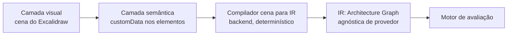

# 04 — Canvas, catálogo e IR

## O problema: liberdade × modelo executável

O Excalidraw é ótimo justamente porque não impõe nada: retângulos, setas e texto livre. Mas o motor precisa saber que *aquele* retângulo é uma fila SQS FIFO com DLQ após 5 tentativas e que *aquela* seta é uma publicação assíncrona. A solução é uma camada semântica por cima do desenho, sem tirar a liberdade:



- A **cena** é a fonte da verdade do desenho e é salva como está.
- O **`customData`** — campo livre que o Excalidraw preserva em cada elemento — guarda tipo, ID estável e configuração.
- A **IR** é sempre derivada: compilada no backend a cada validação ou submissão. Ninguém a edita à mão.

## Como cada elemento é interpretado

| Elemento no canvas | Interpretação |
|---|---|
| Componente inserido pela paleta (grupo: forma âncora + ícone + rótulo) | Nó tipado: `catalogId`, arquétipo, configuração |
| Seta com as duas pontas vinculadas a componentes | Aresta, com interação inferida ou escolhida |
| Frame marcado como fronteira (região, AZ, rede) | Fronteira; os componentes dentro dela herdam o posicionamento |
| Forma desenhada à mão com rótulo reconhecível ("Redis", "Kafka") | Candidato a componente: diagnóstico com sugestão de mapeamento em 1 clique |
| Texto solto, forma sem rótulo, desenho livre | Anotação: aparece na revisão como contexto, não entra na simulação |
| Seta com uma ponta solta | Diagnóstico `IR001` |

## `customData`

```ts
// Gravado pelo app em element.customData; o Excalidraw preserva o campo no JSON da cena.
type LabCustomData =
  | {
      kind: "component";
      componentId: string;           // ID estável da instância (UUIDv7)
      catalogId: string;             // ex.: "aws.sqs.fifo"
      role: "anchor" | "decoration"; // a âncora recebe as setas; ícone e rótulo são decoração
      config: Record<string, unknown>; // validado pelo configSchema do catálogo
      catalogVersion: string;
    }
  | {
      kind: "connection";
      connectionId: string;
      interaction?: Interaction;     // ausente = inferida
      config?: EdgeConfig;
    }
  | {
      kind: "boundary";
      boundaryId: string;
      boundaryType: "region" | "zone" | "network" | "subnet-public" | "subnet-private";
      region?: string;               // ex.: "sa-east-1"
      zone?: string;                 // ex.: "a"
    };

type Interaction =
  | "sync-request"   // HTTP/gRPC: o chamador espera a resposta
  | "async-publish"  // produz para fila, tópico ou stream
  | "async-consume"  // consome de fila, tópico ou stream
  | "data-access"    // computação lendo/escrevendo num armazenamento
  | "replication"    // armazenamento → réplica (mesma região ou outra)
  | "cdc";           // change data capture: armazenamento → stream
```

## Paleta e inserção de componentes

- Painel próprio ao lado do canvas, com busca e categorias: **Borda e rede**, **Computação**, **Dados**, **Mensageria**, **Orquestração**, **Segurança**, **Observabilidade**, **Clientes** e **Externos do desafio** (SPI, bandeira de cartão, B3, bureau de crédito… definidos pela semente, com latência e disponibilidade fixas).
- Inserir = criar um grupo de elementos (forma âncora com rótulo + ícone do serviço) com `convertToExcalidrawElements` e `updateScene`, por clique ou arrastar e soltar (coordenadas convertidas com `viewportCoordsToSceneCoords`).
- Cada inserção gera um `componentId` novo; copiar e colar gera IDs novos (o app reescreve o `customData` no evento de colagem).
- A paleta mostra só os serviços do provedor da tentativa. Um serviço de outro provedor colado na cena vira diagnóstico `IR005`, com o equivalente sugerido.

## Conexões

### Inferência da interação

| Origem (arquétipo) | Destino (arquétipo) | Interação padrão |
|---|---|---|
| qualquer | `messaging.*` | `async-publish` |
| `messaging.*` | `compute.*` | `async-consume` |
| `client.*`, `edge.*`, `compute.*` | `edge.*`, `compute.*`, `external.*` | `sync-request` |
| `compute.*` | `data.*` | `data-access` |
| `data.*` | `data.*` | `replication` |
| `data.*` | `messaging.stream` | `cdc` |

Seta tracejada (`strokeStyle: "dashed"`) desempata para assíncrona. Combinações sem sentido (ex.: `async-consume` saindo de um banco) geram `IR003`.

### Configuração de uma conexão

```ts
type EdgeConfig = {
  protocol?: "https" | "grpc" | "websocket" | "amqp" | "kafka" | "tcp";
  timeoutMs?: number;
  retries?: { max: number; backoff: "none" | "fixed" | "exponential" | "exponential-jitter"; baseMs: number };
  circuitBreaker?: { enabled: boolean; errorRateThreshold: number; openMs: number };
  idempotencyKey?: boolean;          // a chamada carrega chave de idempotência
  callRatio?: number;                // chamadas por requisição (fan-out); padrão 1
  parallelGroup?: string;            // chamadas do mesmo grupo saem em paralelo
  trigger?: "always" | "on-failure"; // on-failure = caminho de compensação/fallback
  failureOf?: string;                // connectionId cuja falha dispara este caminho
  payloadKb?: number;
  ops?: { op: "read" | "write" | "conditional-write" | "transaction"; count: number }[]; // data-access
  delivery?: "direct" | "outbox";    // async-publish: direto ou via outbox transacional
  batchSize?: number;                // async-consume
  mode?: "sync" | "async";           // replication
};
```

## Configuração dos componentes (inspector)

O inspector é gerado a partir do `configSchema` (JSON Schema) do componente no catálogo e agrupado em seções:

| Seção | Exemplos de campos |
|---|---|
| Capacidade | instâncias mín./máx., vCPU, memória, concorrência por instância, autoscaling (métrica, alvo); concorrência reservada/provisionada (funções); partições/shards; modo de capacidade (sob demanda/provisionado); réplicas de leitura |
| Responsabilidades | Multisseleção das capacidades do desafio que este componente cumpre (ex.: `fraud-check`, `pricing`) — é assim que um contêiner genérico vira "o antifraude" |
| Dados | chave de partição (descrição + cardinalidade: alta/média/baixa), consistência de leitura, TTL, retenção |
| Confiabilidade | multi-AZ, réplica entre regiões, DLQ e máximo de entregas, timeout de visibilidade, idempotência do consumidor (estratégia + armazenamento usado para dedupe) |
| Segurança | rede (pública/privada), criptografia em repouso (gerenciada pelo provedor ou pelo cliente via KMS/Key Vault), autenticação na borda (nenhuma, JWT, mTLS), WAF |
| Operação | métricas, logs, tracing, alarmes (ex.: idade da mensagem mais antiga) |

Componentes de segurança e observabilidade (KMS, Key Vault, CloudWatch…) podem ser desenhados no canvas, mas não precisam de setas: as regras leem as configurações acima, e a presença do componente apenas as satisfaz visualmente.

## Fronteiras

- **Região e AZ (MVP):** frames marcados como fronteira. Pertinência pelo `frameId` dos elementos; para retângulos usados como fronteira, por contenção geométrica.
- **Rede e sub-redes (F2):** VPC/VNet, sub-rede pública e privada, para as regras de exposição.
- Componentes regionais por natureza (ex.: SQS, DynamoDB, Pub/Sub) não precisam de AZ: o catálogo declara `scope: regional`, e o motor aplica o modelo multi-AZ do serviço.

## Mapeamento assistido

1. **Aliases do catálogo (determinístico):** o rótulo é normalizado (minúsculas, sem acento) e comparado com os `aliases` dos serviços do provedor. Ex.: "redis", "valkey", "cache" → ElastiCache; "kafka", "msk" → Amazon MSK.
2. **Com IA ligada:** se nenhum alias bater, o adaptador de IA recebe o rótulo, o texto próximo e a lista de serviços do provedor e devolve até 3 candidatos com justificativa.
3. A sugestão aparece no painel de problemas (`IR004`); **nada é aplicado sem o seu clique**. Ao aplicar, o elemento ganha `customData` e o ícone do serviço; o desenho original é preservado.

## Catálogo de componentes

### Arquétipos e serviços do MVP

| Arquétipo | AWS | Azure | GCP |
|---|---|---|---|
| `client.*` (web, mobile, parceiro) | — | — | — |
| `edge.dns` | Route 53 | Azure DNS / Traffic Manager | Cloud DNS |
| `edge.cdn` | CloudFront | Azure Front Door | Cloud CDN |
| `edge.waf` | AWS WAF | Azure WAF | Cloud Armor |
| `edge.api-gateway` | API Gateway | API Management | API Gateway / Apigee |
| `network.load-balancer` | ALB / NLB | Application Gateway / Load Balancer | Cloud Load Balancing |
| `compute.service` | ECS Fargate / EKS | Container Apps / AKS | Cloud Run / GKE |
| `compute.function` | Lambda | Azure Functions | Cloud Run functions |
| `compute.stream-processor` | Managed Service for Apache Flink | Stream Analytics | Dataflow |
| `workflow.orchestrator` | Step Functions | Durable Functions / Logic Apps | Workflows |
| `data.relational` | Aurora PostgreSQL / RDS | Azure Database for PostgreSQL / Azure SQL | Cloud SQL / AlloyDB |
| `data.relational-distributed` | Aurora DSQL | — | Spanner |
| `data.key-value` / `data.document` | DynamoDB | Cosmos DB | Firestore / Bigtable |
| `data.cache` | ElastiCache (Valkey/Redis) | Azure Managed Redis | Memorystore |
| `data.object-storage` | S3 | Blob Storage | Cloud Storage |
| `messaging.queue` | SQS (Standard/FIFO) | Service Bus (filas) | Pub/Sub (assinatura pull) / Cloud Tasks |
| `messaging.topic` | SNS | Service Bus (tópicos) / Event Grid | Pub/Sub |
| `messaging.stream` | Kinesis Data Streams / MSK | Event Hubs | Pub/Sub / Managed Service for Apache Kafka |
| `messaging.event-bus` | EventBridge | Event Grid | Eventarc |
| `security.identity` | Cognito | Entra External ID | Identity Platform |
| `security.secrets` | Secrets Manager / KMS | Key Vault | Secret Manager / Cloud KMS |
| `observability` | CloudWatch | Azure Monitor / Application Insights | Cloud Monitoring / Logging / Trace |
| `external.system` | definidos pela semente (SPI, bandeira, B3…) | idem | idem |

O provedor **Genérico** usa os próprios arquétipos, com ícones neutros.

### Exemplo de definição

```yaml
# content/catalog/aws/messaging/sqs-fifo.yaml
id: aws.sqs.fifo
provider: aws
archetype: messaging.queue
scope: regional                      # multi-AZ gerenciado pelo provedor
displayName: Amazon SQS (FIFO)
icon: icons/aws/sqs.svg
aliases: [sqs fifo, fila fifo, fifo queue]
docs: https://docs.aws.amazon.com/AWSSimpleQueueService/latest/SQSDeveloperGuide/
capabilities:
  ordering: per-message-group        # none | per-key | per-message-group | total
  delivery: at-least-once            # reentrega se o timeout de visibilidade expirar antes do delete
  producerDeduplication: 5m          # deduplica envios iguais dentro da janela
  encryptionAtRest: default-on
  privateEndpoint: true
configSchema:
  type: object
  properties:
    highThroughput: { type: boolean, default: true, title: "Modo alta vazão" }
    visibilityTimeoutSeconds: { type: integer, minimum: 0, maximum: 43200, default: 30 }
    dlq:
      type: object
      properties:
        enabled: { type: boolean, default: false }
        maxReceiveCount: { type: integer, minimum: 1, default: 5 }
performance:                         # VALORES ILUSTRATIVOS: calibrar com a documentação oficial
  enqueueLatencyMs: { p50: 8, p99: 40 }
  throughput:
    limiter: token-bucket
    perMessageGroupPerSecond: 300
    perQueuePerSecond: { highThroughput: 30000, standard: 3000 }
failureModes:
  - { id: throttling, effect: reject, error: 429 }
pricing:                             # ILUSTRATIVO, USD, região sa-east-1
  perMillionRequests: 0.50
source: { url: "https://docs.aws.amazon.com/...", reviewedAt: "2026-11-01" }
```

```yaml
# content/catalog/aws/compute/lambda.yaml (trecho)
id: aws.lambda
archetype: compute.function
configSchema:
  properties:
    memoryMb: { type: integer, enum: [512, 1024, 2048, 4096], default: 1024 }
    reservedConcurrency: { type: integer, minimum: 0 }
    provisionedConcurrency: { type: integer, minimum: 0, default: 0 }
    timeoutMs: { type: integer, default: 3000, maximum: 900000 }
performance:                         # ILUSTRATIVO
  serviceTimeFactorByMemory: { 512: 1.6, 1024: 1.0, 2048: 0.7, 4096: 0.6 }
  coldStartMs: { p50: 250, p99: 1200 }
  concurrency:
    accountLimit: 1000               # cota padrão por região (ajustável)
    scaleRate: { add: 1000, everySeconds: 10 }
pricing:
  perGbSecond: 0.0000166667
  perMillionRequests: 0.20
```

### Regras do catálogo

- Todo valor numérico tem `source` e `reviewedAt`; o CI recusa componente sem fonte (`lab catalog validate`).
- O **arquétipo define o modelo de simulação**; o componente fornece parâmetros. Arquétipo novo exige código no motor; serviço novo de arquétipo existente, só YAML.
- O catálogo tem versão de calendário (ex.: `2026.11.0`), registrada no manifesto de cada avaliação.
- O custo de CPU da lógica de negócio não vem do catálogo, e sim do workload da semente (ex.: "UC-1: 4 ms p50 de CPU por salto de computação"), porque o desenho não tem código.

## IR — Architecture Graph

```json
{
  "irVersion": "1.0",
  "provider": "aws",
  "catalogVersion": "2026.11.0",
  "nodes": [
    { "id": "cmp_client", "catalogId": "client.mobile", "archetype": "client", "label": "App do cliente" },
    { "id": "cmp_apigw", "catalogId": "aws.apigateway.rest", "archetype": "edge.api-gateway", "label": "API Pagamentos",
      "config": { "throttle": { "rps": 5000, "burst": 2000 }, "auth": "jwt" } },
    { "id": "cmp_svc", "catalogId": "aws.ecs.fargate", "archetype": "compute.service", "label": "pix-service",
      "config": { "instances": { "min": 4, "max": 20 }, "vcpu": 1, "memoryGb": 2, "concurrencyPerInstance": 64,
                  "autoscaling": { "metric": "cpu", "target": 0.6 }, "responsibilities": ["fraud-check"] },
      "placement": { "region": "sa-east-1", "zones": ["a", "b"] } },
    { "id": "cmp_db", "catalogId": "aws.aurora.postgresql", "archetype": "data.relational", "label": "ledger",
      "config": { "instanceClass": "db.r6g.xlarge", "multiAz": true, "readReplicas": 1 } },
    { "id": "cmp_q", "catalogId": "aws.sqs.standard", "archetype": "messaging.queue", "label": "eventos-pix",
      "config": { "dlq": { "enabled": true, "maxReceiveCount": 5 } } },
    { "id": "cmp_notif", "catalogId": "aws.lambda", "archetype": "compute.function", "label": "notificador",
      "config": { "reservedConcurrency": 200, "idempotency": { "enabled": true, "storeNodeId": "cmp_db" } } },
    { "id": "external:spi", "catalogId": "external.system", "archetype": "external.system", "label": "SPI (BACEN)" }
  ],
  "edges": [
    { "id": "e1", "from": "cmp_client", "to": "cmp_apigw", "interaction": "sync-request", "config": { "idempotencyKey": true } },
    { "id": "e2", "from": "cmp_apigw", "to": "cmp_svc", "interaction": "sync-request", "config": { "timeoutMs": 3000 } },
    { "id": "e3", "from": "cmp_svc", "to": "cmp_db", "interaction": "data-access",
      "config": { "ops": [ { "op": "transaction", "count": 1 } ] } },
    { "id": "e4", "from": "cmp_svc", "to": "external:spi", "interaction": "sync-request",
      "config": { "timeoutMs": 2000, "retries": { "max": 2, "backoff": "exponential-jitter", "baseMs": 100 },
                  "circuitBreaker": { "enabled": true, "errorRateThreshold": 0.5, "openMs": 30000 } } },
    { "id": "e5", "from": "cmp_svc", "to": "cmp_q", "interaction": "async-publish", "config": { "delivery": "outbox" } },
    { "id": "e6", "from": "cmp_q", "to": "cmp_notif", "interaction": "async-consume", "config": { "batchSize": 10 } },
    { "id": "e7", "from": "cmp_notif", "to": "cmp_db", "interaction": "data-access",
      "config": { "ops": [ { "op": "conditional-write", "count": 1 } ] } }
  ],
  "boundaries": [
    { "id": "b_region", "type": "region", "region": "sa-east-1",
      "members": ["cmp_apigw", "cmp_svc", "cmp_db", "cmp_q", "cmp_notif"] }
  ],
  "flows": [
    { "useCaseId": "UC-1", "steps": ["e1", "e2", "e3", "e4", "e5", "e6", "e7"] }
  ],
  "annotations": [ { "id": "a1", "text": "chave de idempotência = endToEndId", "near": "cmp_svc" } ],
  "sourceMap": { "cmp_svc": ["el_9f2", "el_9f3"], "e4": ["el_a11"] }
}
```

```csharp
// Lab.Ir — esboço dos tipos principais
public sealed record ArchitectureGraph(
    string IrVersion, CloudProvider Provider, string CatalogVersion,
    IReadOnlyList<Node> Nodes, IReadOnlyList<Edge> Edges,
    IReadOnlyList<Boundary> Boundaries, IReadOnlyList<Flow> Flows,
    IReadOnlyList<Annotation> Annotations, SourceMap SourceMap);

public sealed record Node(string Id, string CatalogId, Archetype Archetype, string Label,
    JsonObject Config, Placement? Placement);

public sealed record Edge(string Id, string From, string To, Interaction Interaction, EdgeConfig Config);

public sealed record Flow(string UseCaseId, IReadOnlyList<string> Steps);

public enum Interaction { SyncRequest, AsyncPublish, AsyncConsume, DataAccess, Replication, Cdc }
```

## Compilação cena → IR

1. Ler a cena e descartar elementos `isDeleted`.
2. Indexar elementos por ID, grupos (`groupIds`) e frames.
3. **Nós:** elementos com `customData.kind = "component"` e `role = "anchor"`; validar `config` contra o `configSchema` do catálogo (`IR002` se inválido).
4. **Arestas:** para cada seta, resolver `startBinding.elementId` e `endBinding.elementId` até o componente dono (a própria âncora, outro elemento do grupo ou o contêiner de um texto vinculado). Interação = `customData.interaction` ou inferência. Pontas soltas → `IR001`.
5. **Fronteiras:** frames com `customData.kind = "boundary"`; pertinência por `frameId` ou contenção geométrica.
6. **Anotações:** textos não vinculados e formas sem `customData`, associados ao componente mais próximo.
7. **Candidatos:** formas com rótulo que casa com aliases do catálogo → `IR004` com sugestões.
8. **Fluxos:** carregados da tentativa (referenciam `connectionId`s, estáveis entre edições); passo que aponta para seta apagada → `FLX003`.
9. **Saída:** IR + diagnósticos + `sourceMap` (ID da IR → IDs dos elementos, para destacar no canvas). Nós e arestas ordenados por ID; o JSON canônico gera um `irHash` (SHA-256) usado no manifesto e em caches.

| Diagnóstico | Significado |
|---|---|
| `IR001` | Seta com origem ou destino solto |
| `IR002` | Configuração inválida para o componente |
| `IR003` | Interação incompatível com os arquétipos |
| `IR004` | Forma não tipada reconhecível (sugestão de mapeamento) |
| `IR005` | Serviço de outro provedor |
| `IR006` | Componente fora de qualquer região quando o desafio exige região |
| `IR007` | Ciclo síncrono (A chama B que chama A) |
| `IR008` | Componente isolado, sem conexões |

## Fluxos dos casos de uso

Um fluxo é a lista ordenada de arestas que uma requisição do caso de uso percorre. A semântica é a de uma árvore de chamadas:

- O primeiro passo sai do cliente de entrada do caso de uso.
- Cada passo precisa sair de um nó já alcançado no fluxo (`FLX002` se estiver desconectado).
- Chamadas síncronas que saem do mesmo nó executam em sequência, na ordem dos passos, a menos que compartilhem `parallelGroup`; o nó responde ao chamador quando todas terminam.
- Um `async-publish` abre um **segmento assíncrono**: o chamador segue sem esperar, e o consumo continua num novo segmento, medido como "tempo de conclusão assíncrona".
- Passos com `trigger: on-failure` só executam quando a aresta indicada em `failureOf` falha: é assim que se desenha fallback e compensação (ex.: "se o SPI falhar, publica em `pendencias` para reconciliação").

**Editor:** escolher o UC → clicar nas setas em ordem → selos numerados aparecem nas setas. **Sugerir** (modo Treino) procura no grafo caminhos que partem do cliente e satisfazem as capacidades exigidas pelo UC; se houver mais de um, mostra as alternativas (com IA ligada, ranqueadas). Se não houver nenhum, explica o que falta — o que já é aprendizado.

## Versionamento

| Item | Versão | Onde aparece |
|---|---|---|
| Excalidraw | Versão do pacote fixada, atrás de um adaptador | `package.json` |
| Cena | Schema do Excalidraw + `labSceneVersion` | Snapshot |
| IR | `irVersion` (semver) | IR e manifesto |
| Catálogo | Versão de calendário | Manifesto |
| Fluxos | Junto da tentativa, por `connectionId` | Tentativa |
