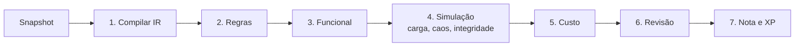

# 05 — Motor de avaliação

O motor é o coração do produto e o maior investimento técnico. Ele responde a uma pergunta: **"se este desenho estivesse em produção com esta carga, o que aconteceria?"**

## O que "testar como se fosse produção" significa aqui

| Pergunta do mundo real | Como o motor responde | Etapa |
|---|---|---|
| Cada caso de uso funciona de ponta a ponta? | Verifica caminhos, capacidades exigidas e ordem dos passos | Funcional |
| Aguenta a carga normal, o pico e um spike? | Simula a carga com o modelo de desempenho de cada serviço | Carga |
| E se uma instância, uma AZ ou uma região cair? E se o SPI ficar lento? | Injeta falhas durante a simulação | Caos |
| Pode debitar duas vezes? Pode perder um evento? Processa fora de ordem? | Injeta entregas duplicadas, retries e crashes, e conta os efeitos | Integridade |
| Está seguro e em conformidade? | Regras sobre rede, criptografia, autenticação, residência e auditoria | Regras |
| Quanto custa por mês? | Recursos e uso simulados × tabela de preços | Custo |
| O que eu deveria ter feito diferente? | Revisão montada a partir das evidências acima | Revisão |

Tudo é **determinístico**: mesma entrada, mesma semente e mesmas versões produzem o mesmo resultado, byte a byte. A IA, quando ligada, só escreve uma narrativa por cima da revisão.

## Pipeline



| Etapa | Entrada | Saída | Orçamento de tempo |
|---|---|---|---|
| 1. Compilar | cena + fluxos + catálogo | IR, diagnósticos, `sourceMap` | < 100 ms |
| 2. Regras | IR + desafio | achados ARQ, DAT, SEC, OPS | < 200 ms |
| 3. Funcional | IR + casos de uso | resultado por UC | < 100 ms |
| 4. Simulação | IR + workload + cenários + semente | métricas, séries temporais, SLOs | ≤ 25 s |
| 5. Custo | IR + métricas + preços | custo mensal com breakdown | < 100 ms |
| 6. Revisão | tudo acima + solução de referência | revisão estruturada | < 200 ms (narrativa por IA: opcional, assíncrona) |
| 7. Nota | tudo acima | notas, rank, XP | < 50 ms |

Erros de compilação graves (ex.: UC sem nenhum caminho possível) não interrompem o pipeline: o UC afetado é reprovado e o restante segue, para o feedback ser completo.

## Etapa 2 — Regras

Regras são funções puras sobre a IR e o desafio. Cada regra declara a dimensão que afeta, a severidade, quando se aplica (ex.: SEC-005 só se o desafio exigir residência de dados) e qual cenário pode confirmá-la. O texto de cada regra (por quê, como corrigir, trade-offs, perguntas de follow-up, links oficiais) fica em `content/rules/` — escrito em tempo de autoria com o Claude Code.

| ID | Dimensão | Severidade | Regra |
|---|---|---|---|
| ARQ-001 | Resiliência | Alta | Ponto único de falha: componente com 1 instância ou 1 AZ no caminho síncrono de um UC crítico |
| ARQ-002 | Resiliência | Alta | Chamada síncrona sem timeout, ou com timeout maior que o SLO do UC |
| ARQ-003 | Resiliência | Média | Retry sem backoff com jitter, ou retries × timeout acima do SLO |
| ARQ-004 | Resiliência | Média | Fila ou assinatura sem DLQ |
| ARQ-005 | Resiliência | Alta | Dependência externa no caminho crítico sem circuit breaker ou caminho de fallback |
| ARQ-006 | Performance | Média | Cadeia síncrona com mais de 4 saltos, ou soma dos p99 acima do SLO |
| ARQ-007 | Performance | Média | Chamada síncrona entre regiões no caminho crítico |
| ARQ-008 | Escalabilidade | Alta | Consumidores > partições do stream (ociosos), ou partições insuficientes para a vazão |
| ARQ-009 | Escalabilidade | Média | Função serverless acessando banco relacional sem pool ou proxy de conexões |
| ARQ-010 | Escalabilidade | Alta | Chave de partição de baixa cardinalidade em fluxo com muita escrita (partição quente) |
| ARQ-011 | Acoplamento | Baixa | Banco compartilhado por 3 ou mais serviços que escrevem nele |
| DAT-001 | Consistência | Crítica | Dual-write: grava no banco e publica evento no mesmo passo, sem outbox nem CDC |
| DAT-002 | Consistência | Crítica | Consumidor em fluxo monetário sem idempotência, ou sem armazenamento de dedupe acessível |
| DAT-003 | Consistência | Crítica | API de comando monetário sem chave de idempotência |
| DAT-004 | Consistência | Alta | UC exige ordenação por chave, mas o broker não garante (fila standard, tópico sem chave) |
| DAT-005 | Consistência | Alta | Atualização de saldo sem controle de concorrência (escrita condicional ou transação) |
| DAT-006 | Consistência | Alta | Cache usado como fonte da verdade de saldo ou limite |
| DAT-007 | Consistência | Média | Leitura de réplica assíncrona em UC que exige ler a própria escrita |
| DAT-008 | Durabilidade | Alta | RPO exigido = 0 com replicação assíncrona entre AZs ou regiões |
| SEC-001 | Segurança | Alta | Banco, cache ou fila acessível por rede pública |
| SEC-002 | Segurança | Alta | API de cliente sem autenticação ou autorização na borda |
| SEC-003 | Segurança | Média | Borda pública sem WAF ou rate limit |
| SEC-004 | Segurança | Alta | Sem criptografia em repouso, ou sem gestão de chaves quando o desafio exige |
| SEC-005 | Compliance | Alta | Dado pessoal ou financeiro fora da região exigida (residência de dados) |
| SEC-006 | Compliance | Média | Sem trilha de auditoria imutável (append-only ou WORM) para transações |
| SEC-007 | Segurança | Média | Segredos fora de um cofre (Secrets Manager, Key Vault, Secret Manager) |
| OPS-001 | Operação | Média | Componente do caminho crítico sem métricas, logs ou tracing |
| OPS-002 | Operação | Baixa | Fila sem alarme de backlog ou de idade da mensagem mais antiga |

**Perfis de compliance** ativam e ponderam regras conforme o desafio:

| Perfil | Ativa | Observação |
|---|---|---|
| `lgpd` | SEC-004, SEC-006, minimização e retenção declaradas | Didático |
| `bacen-4893` | SEC-004, SEC-006, SEC-007, OPS-001, continuidade compatível com o RTO | Inspirado na política de segurança cibernética e contratação de nuvem para instituições autorizadas pelo BACEN; didático |
| `pci-dss` | SEC-001, SEC-002, SEC-004, tokenização do PAN, segmentação do ambiente de cartão (F2) | Didático |

A restrição "dados no Brasil" é uma regra do desafio inspirada em exigências comuns do setor, não uma interpretação jurídica.

```csharp
public interface IArchitectureRule
{
    string Id { get; }                          // "DAT-001"
    Dimension Dimension { get; }
    Severity DefaultSeverity { get; }
    IReadOnlyList<string> ConfirmedBy { get; }   // ex.: ["integrity.lostEvents"]
    bool AppliesTo(ChallengeSpec challenge);
    IEnumerable<Finding> Evaluate(ArchitectureGraph graph, ChallengeSpec challenge, Catalog catalog);
}
```

Cada regra tem ao menos um teste positivo e um negativo com grafos pequenos.

## Etapa 3 — Testes funcionais

Para cada caso de uso:

1. **Caminho:** o fluxo existe, começa no cliente de entrada, todos os passos estão conectados, e o segmento síncrono devolve resposta ao cliente.
2. **Capacidades exigidas:** cada capacidade é cumprida por algum passo, na ordem exigida.
3. **Caminhos negativos:** quando o desafio exige comportamento em falha (ex.: "se o SPI estiver indisponível, a transação fica pendente e é reconciliada, nunca some"), existe um passo `trigger: on-failure` que cumpre essa exigência.
4. **Invariantes:** pós-condições verificadas na simulação (ex.: "todo PIX aprovado gera exatamente um débito e um crédito").

| Capacidade | Cumprida quando |
|---|---|
| `authenticate` | Gateway de borda com `auth ≠ none`, ou componente de identidade no caminho |
| `idempotency-check` | Passo com `idempotencyKey: true`, e o nó que o recebe acessa um armazenamento com escrita condicional ou única |
| `durable-write` | `data-access` com escrita em armazenamento durável (cache não conta); no segmento síncrono quando `before: respond` |
| `atomic-balance-update` | Operação `transaction` ou `conditional-write` num armazenamento com essa capacidade |
| `publish-event` | Aresta `async-publish` |
| `external-call` | `sync-request` para o sistema externo indicado |
| `audit-log` | Escrita em armazenamento com capacidade `immutability` (object lock, tabela append-only) |
| `<responsabilidade>` (ex.: `fraud-check`) | Nó de computação com a responsabilidade marcada no inspector, alcançado no ponto certo do fluxo |

Resultado por UC: aprovado, parcial ou reprovado, com motivos e elementos envolvidos.

## Etapa 4 — Simulação

### Workload (definido pela semente)

```yaml
workload:
  entryClients:
    - id: client.mobile
      useCases:
        UC-1: { share: 0.70, payloadKb: 2, computeCostMs: { p50: 4, p99: 15 } }   # CPU por salto de computação
        UC-2: { share: 0.30, payloadKb: 1, computeCostMs: { p50: 1, p99: 4 } }
  baselineRps: 1500
  keyDistribution: { type: zipf, s: 1.1, keys: 5000000 }   # contas; gera chaves quentes
  hotKeys: [ { key: "conta-varejista-x", shareOfWrites: 0.03 } ]   # "conta quente"
  cacheability: { UC-2: 0.85 }   # fração máxima das leituras que um cache pode atender
  dailyPattern: payday            # perfil diário usado no custo e no soak
```

O usuário não declara a taxa de acerto do cache: ela é limitada pela `cacheability` do workload. Isso impede "resolver" o desafio declarando 100% de acerto.

### Modelo de cada arquétipo

| Arquétipo | Modelo | Parâmetros principais |
|---|---|---|
| `edge.api-gateway`, `network.load-balancer` | Rate limiter (token bucket) + latência fixa | rps, burst, latência p50/p99 |
| `compute.service` | Fila multi-servidor (G/G/c): c = instâncias × concorrência; tempo de serviço log-normal (custo de CPU do UC × fator do tamanho); autoscaling com atraso | mín./máx., alvo, cooldown, tempo de provisionamento |
| `compute.function` | Servidores elásticos com teto de concorrência, taxa de escala e cold start | concorrência reservada/provisionada, limite da conta, cold start |
| `data.relational` | Primário com escritor único (c conexões); réplicas de leitura com atraso; failover com janela de indisponibilidade; contenção por linha quente (exclusão mútua por chave) | classe da instância, conexões, multi-AZ, réplicas |
| `data.key-value`, `data.document` | Partições com limite próprio (token bucket por partição) + distribuição de chaves do workload | modo de capacidade, partições derivadas, consistência |
| `data.cache` | Acerto ≤ `cacheability`; latência baixa; se o cache cai, todas as leituras vão para a origem | nós, réplicas |
| `messaging.queue` | Backlog, entrega pelo menos uma vez, timeout de visibilidade e reentrega, DLQ, limites de vazão (FIFO por grupo) | tipo, visibilidade, DLQ |
| `messaging.stream` | Partições com vazão máxima por partição, ordem por chave, paralelismo de consumo ≤ partições | partições, retenção |
| `messaging.topic`, `messaging.event-bus` | Fan-out para N assinaturas, cada uma com sua fila | assinaturas |
| `external.system` | Caixa-preta: latência, disponibilidade, rate limit e janelas de degradação definidos pela semente | — |
| `workflow.orchestrator` | Estado por passo; latência e custo por transição | — |

**Rede:** latência por tipo de salto — mesma AZ, entre AZs, entre regiões, internet — com valores do catálogo (ex.: São Paulo ↔ Virgínia do Norte na casa de 120 ms de ida e volta, ilustrativo). Transferência entre AZs, entre regiões e para a internet também entra no custo.

### Semântica das conexões

- **Síncrona:** o chamador espera. Se a resposta passa do `timeoutMs`, o chamador recebe timeout — e o trabalho do chamado continua, desperdiçado, como na vida real. Retries reenviam após o backoff e **multiplicam a carga** (retry storm). Circuit breaker aberto falha rápido durante `openMs`.
- **Fan-out e paralelismo:** `callRatio` multiplica chamadas por requisição; `parallelGroup` dispara chamadas em paralelo e espera a mais lenta.
- **Assíncrona:** `async-publish` retorna após o ack do broker; o consumo acontece em lotes (`batchSize`) e alimenta o tempo de conclusão assíncrona.
- **Outbox × direto:** com `delivery: outbox`, a publicação é atômica com o commit (latência extra do relay, sem perda); com `direct`, um crash entre o commit e a publicação perde o evento.
- **Fallback:** passos `trigger: on-failure` executam quando a aresta indicada falha.

### Autoscaling

A cada intervalo de avaliação (ex.: 60 s), o componente compara a métrica com o alvo (target tracking) e adiciona instâncias proporcionalmente, respeitando o máximo, o tempo de provisionamento (contêineres: dezenas de segundos a minutos; funções: taxa de escala do catálogo) e o cooldown. Scale-in é conservador. É isso que faz um spike de 30 s doer mesmo com autoscaling bem configurado.

### Falhas injetáveis

| Tipo | Efeito |
|---|---|
| `instance-kill` | Remove N instâncias de um componente no instante t |
| `zone-outage` | Derruba os componentes posicionados só na AZ; serviços multi-AZ fazem failover com a janela do catálogo |
| `region-outage` (F2) | Derruba a região inteira; mede RTO e RPO |
| `latency-injection` | Adiciona latência a um componente ou externo (p50/p99) durante um intervalo |
| `dependency-outage` | Externo indisponível durante um intervalo |
| `throttling` | Reduz limites de um serviço gerenciado |
| `duplicate-delivery` | Broker reentrega a mesma mensagem com probabilidade p |
| `client-retry` | Cliente reenvia após timeout, com ou sem a mesma chave de idempotência |
| `consumer-crash` (F2) | Consumidor cai depois do efeito e antes do ack → reentrega |
| `publish-crash` (F2) | Processo cai entre o commit no banco e a publicação direta |
| `reorder` (F2) | Entregas concorrentes sem ordenação por chave |
| `replica-lag` (F2) | Réplicas assíncronas com atraso |

### Integridade de dados

Cada requisição de um UC monetário carrega um ID lógico de transação. O motor registra os efeitos colaterais por nó (débitos, créditos, notificações enviadas) e confere as invariantes:

| Contador | Incrementa quando |
|---|---|
| `duplicateEffects` | Um efeito é aplicado mais de uma vez para a mesma transação (consumidor ou serviço sem idempotência diante de reentrega ou retry) |
| `lostEvents` | Um evento esperado nunca chega ao consumidor (ex.: dual-write + `publish-crash`) |
| `orderingViolations` | Eventos da mesma chave processados fora de ordem num UC que exige ordem |
| `staleReads` | Leitura de réplica anterior à própria escrita num UC que exige ler a própria escrita |

Para um engenheiro do mercado financeiro, esta é a parte mais valiosa: o app mostra o **número de cobranças duplicadas** que o desenho produziria, não um aviso genérico.

### Núcleo de simulação

```csharp
public sealed class SimulationKernel
{
    private readonly PriorityQueue<SimEvent, (long TimeUs, long Seq)> _queue = new();
    private long _nowUs, _seq;
    public long NowUs => _nowUs;

    public void Schedule(long delayUs, SimEvent ev) => _queue.Enqueue(ev, (_nowUs + delayUs, _seq++));

    public void RunUntil(long untilUs, CancellationToken ct)
    {
        while (_queue.TryPeek(out _, out var key) && key.TimeUs <= untilUs)
        {
            var ev = _queue.Dequeue();
            _nowUs = key.TimeUs;
            ev.Handle(this);
            if ((_seq & 0xFFFF) == 0) ct.ThrowIfCancellationRequested();
        }
    }
}
```

- **Relógio virtual** em microssegundos; desempate por número de sequência, garantindo ordem determinística.
- **Aleatoriedade própria** (PCG ou xoshiro256\*\*), não `System.Random`, para a sequência não mudar entre versões do .NET. Um fluxo de números por propósito (ex.: `node:cmp_svc:service-time`), derivado da semente mestra por um hash estável — nunca `string.GetHashCode()`, que é randomizado por processo.
- **Números aleatórios comuns:** a semente mestra é fixa por desafio, então todas as tentativas enfrentam exatamente a mesma sequência de chegadas. Comparar a tentativa 1 com a 2 é justo.
- **Métricas:** histogramas de latência por UC e por nó (estilo HdrHistogram) e séries em janelas de 1 s.
- **Paralelismo:** cada execução é single-thread e determinística; cenários e replicações rodam em paralelo.
- **Replicações:** 3 por cenário na submissão (1 na simulação de rascunho), com intervalo de confiança de 95% exibido para o p99.

### Modelo analítico

Antes da simulação, e para a capacidade estimada ao vivo (F2):

- Taxa de chegada por nó: λ_nó = Σ_UC λ_UC × visitas × `callRatio` × amplificação estimada por retries.
- Utilização: ρ = λ / (c × μ). ρ ≥ 0,85 é alerta; ρ ≥ 1 é saturação.
- Espera: Erlang C (M/M/c) com correção de Allen–Cunneen para G/G/c: Wq ≈ Wq(M/M/c) × (Ca² + Cs²) / 2.
- Limites de serviços gerenciados: o excedente acima do limite é rejeitado.

Usos: estimativa instantânea no canvas, escolha da escala da simulação, atalho quando ρ ≫ 1 (o resultado analítico + 30 s de simulação já mostram o colapso) e verificação cruzada nos testes.

### Escala e desempenho

- Meta: ≥ 2 milhões de eventos/s por núcleo; orçamento de 20 milhões de eventos por execução.
- Janelas padrão: baseline 120 s + 30 s de aquecimento; pico com rampa de 60 s + 120 s sustentados; spike em 180 s.
- Acima do orçamento: (1) encurtar janelas estacionárias; (2) amostrar por um fator k (λ/k e capacidades/k em nós com c grande, onde o efeito de agrupamento é desprezível); (3) para saturação evidente, atalho analítico. A estratégia final sai do spike S2.

### Cenários e SLOs

Os cenários fazem parte da semente. Os públicos estão no enunciado; os ocultos testam o que um bom desenho deveria antecipar a partir dos requisitos declarados.

```yaml
testPlan:
  scenarios:
    - { id: baseline, kind: load, visibility: public,
        load: { profile: constant, rps: "{{baselineRps}}", duration: 120s, warmup: 30s } }
    - { id: payday-peak, kind: load, visibility: public,
        load: { profile: ramp, fromRps: "{{baselineRps}}", toRps: "{{baselineRps * 5}}", rampFor: 60s, holdFor: 120s } }
    - { id: flash-spike, kind: load, visibility: hidden,
        load: { profile: spike, baseRps: "{{baselineRps}}", peakRps: "{{baselineRps * 15}}", at: 60s, for: 30s, duration: 180s } }
    - { id: az-outage, kind: chaos, visibility: hidden, load: { ref: baseline },
        faults: [ { type: zone-outage, zone: a, at: 60s, for: 90s } ] }
    - { id: spi-slow, kind: chaos, visibility: hidden, load: { ref: baseline },
        faults: [ { type: latency-injection, target: "external:spi", addMs: { p50: 800, p99: 3000 }, at: 30s, for: 120s } ] }
    - { id: duplicates, kind: integrity, visibility: hidden, load: { ref: baseline, duration: 120s },
        faults: [ { type: duplicate-delivery, probability: 0.02 },
                  { type: client-retry, onTimeoutMs: 1500, sameIdempotencyKey: true } ] }
  slos:
    - { id: SLO-1, useCase: UC-1, metric: latency.p99, max: 1000ms, scenarios: [baseline, payday-peak, flash-spike] }
    - { id: SLO-2, useCase: UC-1, metric: success-rate, min: 99.95%, scenarios: [baseline, payday-peak, flash-spike, az-outage, spi-slow] }
    - { id: SLO-3, useCase: UC-3, metric: async-completion.p95, max: 5s, scenarios: [baseline] }
    - { id: SLO-4, metric: duplicate-effects, max: 0, scenarios: [duplicates] }
    - { id: SLO-5, metric: lost-events, max: 0, scenarios: [duplicates, az-outage] }
```

Cada par (SLO, cenário) vira uma **verificação** com resultado e pontuação parcial (ver Etapa 7). Falhas são referenciadas a um alvo do desafio (`external:spi`, zona `a`), nunca a IDs do desenho do usuário.

### Saída de um cenário

```json
{
  "scenarioId": "payday-peak",
  "seed": 4211, "replications": 3,
  "useCases": {
    "UC-1": { "requests": 1840000, "successRate": 0.302,
              "latencyMs": { "p50": 180, "p95": 420, "p99": 610, "p99Ci95": [590, 634] },
              "errors": { "throttled": 1284000, "timeout": 0, "unavailable": 0 } }
  },
  "nodes": {
    "cmp_fn": { "concurrency": { "max": 1000, "limit": 1000 }, "throttled": 1284000 },
    "cmp_q": { "backlog": { "max": 1200 }, "oldestMessageAgeS": { "max": 3 } }
  },
  "bottlenecks": [ { "nodeId": "cmp_fn", "reason": "concurrency-limit", "needed": 3375, "limit": 1000 } ],
  "integrity": { "duplicateEffects": 0, "lostEvents": 0, "orderingViolations": 0, "staleReads": 0 },
  "checks": [ { "slo": "SLO-2", "status": "fail", "observed": 0.302, "target": 0.9995, "score": 0 } ]
}
```

As séries temporais (vazão, erros, latência, utilização e filas, em janelas de 1 s) são gravadas comprimidas e alimentam os gráficos e o replay.

## Etapa 5 — Custo

- **Mensal na carga baseline:** recursos provisionados × 730 h + uso (requisições, GB armazenados, GB transferidos) + média de instâncias extras durante os picos do `dailyPattern` (ex.: 2 h/dia em pico no dia de pagamento). O volume do mês é `baseline × (horas normais + horas de pico × multiplicador) × 30 dias`; as instâncias médias de contêineres vêm da simulação do baseline e do pico público.
- **Lotes contam:** uma função que consome uma fila em lotes de 10 é cobrada por invocação de lote; leitura e remoção na fila também.
- **Transferência de dados** para a internet entra explicitamente: é um custo que quase todo mundo esquece. Entre AZs e entre regiões entra na F2 (o resultado avisa que ainda não está na conta).
- **Preços** da região do desafio (São Paulo costuma custar mais que Virgínia do Norte — bom de aprender), em tabelas versionadas e ilustrativas, com fonte e data.
- **Saída:** breakdown por componente e por categoria, com a base de cálculo de cada linha ("15 instâncias em média × 2 vCPU × 730 h"), comparação com o orçamento e com o custo da solução de referência — que é simulada nos mesmos cenários de baseline e pico e guardada em cache por desafio.

## Etapa 6 — Revisão

A revisão é **determinística** e montada a partir de textos curados:

| Parte | Origem |
|---|---|
| Resumo | Os 3 problemas de maior impacto na nota, em ordem |
| Pontos fortes | SLOs críticos aprovados, padrões bem aplicados (outbox, idempotência, circuit breaker…) |
| Pontos de melhoria | Cada achado ou verificação reprovada → texto curado da regra + números da simulação ("concorrência necessária ≈ 3.400; limite 1.000") + elementos destacáveis no canvas |
| Perguntas de follow-up | Curadas por regra e por cenário (ex.: ARQ-005 → "O que acontece com os pagamentos pendentes se o SPI ficar fora por 10 minutos?") |
| Comparação com a referência | Diff estrutural: padrões e componentes presentes na referência e ausentes na tentativa, e vice-versa |
| Para estudar | Tópicos e links oficiais associados às regras disparadas |

Com IA ligada, um adaptador escreve uma **narrativa** por cima (ver [06](06-ia.md)). Ela pode citar só o que está na revisão determinística; elementos e números citados são conferidos pelo servidor. **A narrativa nunca altera a nota.**

## Etapa 7 — Nota

### Dimensões e pesos padrão

| Dimensão | Peso padrão | Fontes |
|---|---|---|
| Funcional | 20 | Testes funcionais por UC |
| Performance e escala | 20 | Verificações dos cenários de carga; folga de utilização |
| Resiliência | 15 | Verificações dos cenários de caos; RTO/RPO; regras ARQ |
| Consistência e integridade | 20 | Verificações dos cenários de integridade; regras DAT |
| Segurança e compliance | 10 | Regras SEC conforme o perfil de compliance |
| Custo | 10 | Custo × orçamento × referência |
| Operabilidade | 5 | Regras OPS e cobertura de observabilidade no caminho crítico |

A semente pode redistribuir os pesos (ex.: um desafio de ledger dá 30 para Consistência).

### Fórmulas

```text
Verificação de SLO de máximo (latência, tempo assíncrono):
  observado ≤ limite  → 1
  senão               → max(0, 1 − (observado − limite) / limite)      # 2× o limite → 0

Verificação de SLO de taxa de sucesso:
  orçamento_de_erro = 1 − alvo                                           # 99,95% → 0,0005
  erro ≤ orçamento    → 1
  senão               → max(0, 1 − log10(erro / orçamento) / 2)        # 10× → 0,5 ; 100× → 0

Verificação de integridade (duplicidade, perda, ordenação):
  UC monetário        → 1 se violações = 0, senão 0
  demais UCs          → max(0, 1 − violações / (0,001 × requisições))

nota_cenário  = menor pontuação entre as verificações do cenário naquela dimensão
                # um cenário só passa se todos os SLOs dele passarem: o pico com 84,7% de sucesso vale 0,
                # mesmo com o p99 dentro do limite
nota_dimensão = 100 × média ponderada dos cenários − penalidades de regras não confirmadas
  peso do cenário: 2 se envolve um UC crítico, 1 nos demais
  penalidades: crítica 25 · alta 10 · média 4 · baixa 1, somadas por achado e limitadas a 2× a
               severidade mais alta da regra (nota mínimo 0)
  regra confirmada = o efeito que ela prevê apareceu num cenário E derrubou uma verificação desse
                     cenário (ex.: DAT-002 + efeitos duplicados > 0 no cenário de duplicidade).
                     Ela não é penalizada de novo: a verificação reprovada já cobrou.

Folga de capacidade (Performance): utilização média do componente mais ocupado no baseline
  ≤ 75% → 1 ; senão max(0, 1 − (utilização − 0,75) / 0,25)        # entra como verificação de peso 1

Custo:
  custo ≤ orçamento   → 100 − 40 × max(0, custo / custo_referência − 1,5)
  custo > orçamento   → max(0, 100 × (1 − 2 × (custo / orçamento − 1)))  # 50% acima → 0

nota_base  = Σ peso_d × nota_d / 100
teto       = 50 se algum UC não tem caminho válido
             60 se há violação de integridade em UC monetário
             100 nos demais casos
nota_final = round(min(nota_base, teto))
rank       = S ≥ 90 · A ≥ 80 · B ≥ 70 · C ≥ 60 · D < 60
```

A revisão ordena os pontos de melhoria pelo **impacto na nota final**: a perda de cada cenário é dividida entre as regras confirmadas que o explicam (ou vira um item do próprio cenário, com o gargalo da simulação como evidência); quando a dimensão bate no zero, as perdas são reescaladas para somar a perda real; o que a trava tirou vai para os itens que a causaram.

As travas reproduzem um design review real: um desenho que perde ou duplica dinheiro não passa, por mais rápido que seja. A tela de resultado mostra a contribuição de cada verificação e regra — toda pontuação é explicável.

**Anti-trapaça embutida:** réplicas infinitas passam na carga, mas destroem a nota de custo; cotas e limites de conta no catálogo impedem escala ilimitada; acerto de cache vem do workload.

## Reprodutibilidade

```json
{
  "engineVersion": "0.4.2",
  "catalogVersion": "2026.11.0",
  "rulesVersion": "0.4.2",
  "challengeId": "chl_01JD…", "seedId": "pix/envio-pix", "seedVersion": 3,
  "variation": { "baselineRps": 1500, "twists": ["spi-degradado"] },
  "irHash": "sha256:…",
  "masterSeed": 913337,
  "scenarioSetHash": "sha256:…",
  "narrative": { "mode": "ollama", "model": "…", "promptVersion": "narrator@2" },
  "createdAt": "2026-11-15T19:20:00Z"
}
```

Reavaliar o mesmo manifesto devolve o resultado em cache; recalcular do zero produz o mesmo resultado byte a byte (verificado nos testes de propriedade). Para isso o motor sempre formata números e mensagens em pt-BR, independente da cultura da máquina, e o hash do resultado ignora só os tempos de relógio.

## Como sabemos que o motor está certo

1. **Testes "golden" contra a teoria:** M/M/1 com ρ = 0,5, 0,8 e 0,95 (espera média a ±3% do analítico); M/M/c contra Erlang C; M/D/1.
2. **Lei de Little (L = λW)** verificada em cada nó em toda execução de teste.
3. **Propriedades (CsCheck):** determinismo (mesma semente → mesmo hash do resultado), conservação (entradas = concluídas + falhas + em voo), monotonicidade estatística (mais capacidade não piora o p99 em regime estacionário, com tolerância), ausência de tempos negativos.
4. **Histórias conhecidas como testes:** retry storm, thundering herd depois de um flush do cache, partição quente, abismo de concorrência de funções serverless, lag de consumidor com menos partições que consumidores, janela sem escrita no failover de um banco de primário único durante a queda de AZ — cada uma com o resultado qualitativo esperado.
5. **Calibração:** valores do catálogo com fonte e data; revisão periódica com a skill `calibrar-catalogo` do Claude Code.
6. **Sensibilidade (F2):** o resultado mostra quais premissas mais mexem na nota ("sua nota de Performance depende muito da latência assumida do SPI").

## Limitações conhecidas (exibidas no app)

- Não modela código de aplicação (GC, consultas N+1, locks na aplicação): só o custo de CPU declarado no workload.
- Rede simplificada por tipo de salto.
- Serviços gerenciados são caixas-pretas parametrizadas; autoscaling real é aproximado.
- Os números do catálogo são aproximações; cotas e preços mudam.
- A nota mede aderência aos SLOs do desafio sob as premissas do modelo. Ela não garante que o desenho funcione em produção.

## Exemplo ponta a ponta (ilustrativo)

**Desafio** "Envio de PIX da FinBank" — AWS, Sênior, Treino.

- UC-1 Enviar PIX (monetário): autenticar → checar idempotência → debitar saldo de forma atômica → chamar o SPI → publicar evento. SLOs: p99 ≤ 1.000 ms; sucesso ≥ 99,95%.
- UC-2 Consultar status: p99 ≤ 200 ms. UC-3 Notificar o recebedor (assíncrono): p95 ≤ 5 s, sem perda.
- Carga: baseline 1.500 TPS; pico 5x no dia de pagamento; spike 15x por 30 s. SPI: p50 120 ms, p99 400 ms. Orçamento US$ 59.000/mês; dados no Brasil.
- Públicos: baseline e pico. Ocultos: spike, queda de AZ, SPI lento, duplicidade.

**Tentativa 1:** Cliente → API Gateway → Lambda `pix-sender` → DynamoDB (escrita condicional com a chave de idempotência) → SPI (timeout 2 s, 2 retries, sem circuit breaker) → SNS (publicação direta) → Lambda `notificador` (sem idempotência) → provedor de push.

| Verificação | Resultado |
|---|---|
| Funcional | 3/3 UCs com caminho e capacidades ✓ |
| Baseline | p99 640 ms ✓ · sucesso 99,99% ✓ |
| Pico 5x | ✗ 70% das requisições rejeitadas. Lei de Little: concorrência necessária ≈ 7.500 TPS × 0,45 s ≈ 3.400 execuções, contra um limite de 1.000 |
| Spike 15x (oculto) | ✗ mesmo gargalo, pior |
| Queda de AZ (oculto) | ✓ serviços regionais multi-AZ |
| SPI lento (oculto) | ✗ timeouts + retries multiplicam a carga; sucesso cai para 62% durante o evento |
| Duplicidade (oculto) | Débitos duplicados: 0 ✓ · notificações duplicadas: 37 ✗ · eventos perdidos: 14 ✗ (F2, com `publish-crash`) |
| Custo | US$ 52.800/mês ✓ (orçamento de US$ 59.000) |

Notas: Funcional 100 · Performance 38 · Resiliência 45 · Consistência 72 · Segurança 80 · Custo 90 · Operação 60 → **69 (C)**. Sem trava: as violações de integridade estão no UC-3, que não é monetário.

Pontos de melhoria gerados: (1) limite de concorrência da Lambda no pico → cota maior + concorrência provisionada, ou contêineres com autoscaling; (2) circuit breaker, timeout menor e retry com jitter no SPI, com fila de pendências para reconciliação; (3) outbox transacional — por exemplo, DynamoDB Streams como CDC — para não perder eventos; (4) notificador idempotente, com dedupe por `endToEndId`.

**Tentativa 2**, com as quatro correções: **88 (A)**. A tentativa 1 rendeu 241 XP; a 2 rende só a melhoria: 318 − 241 = **77 XP** (ver [07](07-gamificacao.md)).

## Fase 4 — Sandbox real (opcional, local)

Para quem quiser ver o desenho rodando "de verdade", sem custo de nuvem:

- A IR vira um `docker-compose` gerado. Cada componente de computação vira um contêiner genérico `lab-node` (uma minimal API .NET configurada pela IR: rotas, chamadas a jusante, CPU e latência simuladas, idempotência, outbox). Dados e mensageria viram serviços reais ou emuladores: PostgreSQL, Valkey, Kafka, RabbitMQ, LocalStack, Azurite, emuladores do Service Bus, Cosmos DB, Pub/Sub e Firestore (verificar a licença e a edição de cada um).
- Carga com k6 ou NBomber; falhas com Toxiproxy; métricas via OpenTelemetry Collector convertidas para o mesmo schema de resultado e para a mesma nota, com o selo "medido em sandbox".
- Sempre local, nunca na sua conta de nuvem. Exportar IaC (Terraform) fica como material de estudo, sem aplicar.
