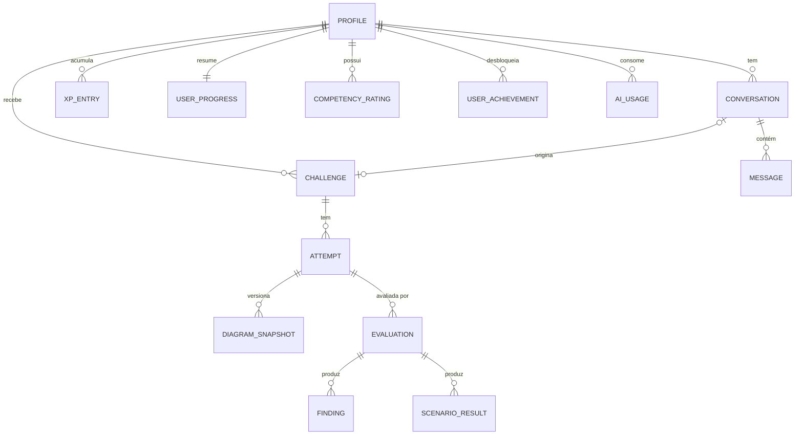
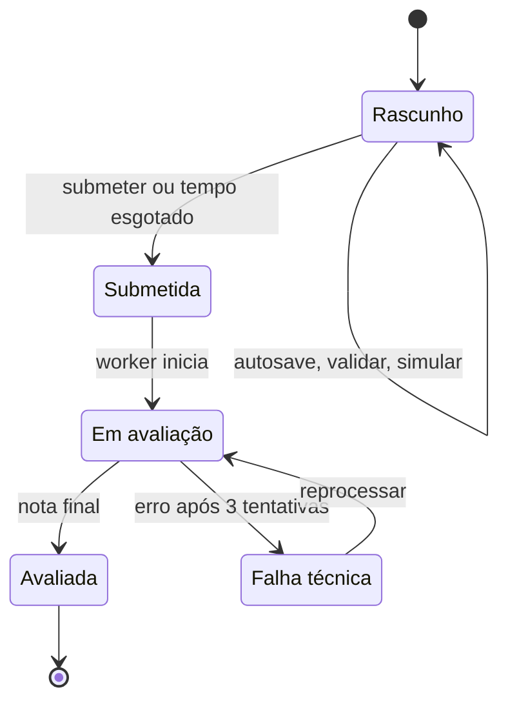

# 08 — Dados e API

## Modelo de dados

SQLite, um arquivo, tabelas com prefixo por módulo. IDs UUIDv7 (`Guid.CreateVersion7()`), ordenáveis por tempo. JSON em colunas `TEXT`; séries temporais comprimidas (gzip) em `BLOB`. Sementes, catálogo, textos das regras e prompts **não** ficam no banco: são arquivos do repositório carregados na inicialização, com hash de versão.

| Tabela | Colunas principais | Observações |
|---|---|---|
| `profile_profiles` | id, display_name, locale, default_provider, preferences (JSON) | Um perfil local |
| `conv_conversations` | id, profile_id, challenge_id?, kind (new-challenge, interviewer), provider, ai_mode, created_at | |
| `conv_messages` | id, conversation_id, role, content, masked_items, created_at | |
| `chl_challenges` | id, profile_id, seed_id, seed_version, variation (JSON), personalization (JSON), public (JSON), hidden (JSON), master_seed, reference_score, status, created_at | `hidden` nunca vai para o frontend |
| `dsg_attempts` | id, challenge_id, number, provider, mode, status, draft_scene (JSON), draft_version, flows (JSON), hints_used, started_at, submitted_at, deadline_at? | O rascunho do autosave fica aqui, com versão para concorrência otimista |
| `dsg_snapshots` | id, attempt_id, kind (checkpoint, validate, simulate, submit), scene (JSON), ir (JSON), ir_hash, diagnostics (JSON), created_at | Snapshot em ações explícitas e a cada 5 min de edição, não a cada autosave |
| `eva_evaluations` | id, attempt_id, snapshot_id, kind (draft, submission), status, stage, manifest (JSON), scores (JSON), final_score, rank, review (JSON), narrative (JSON)?, started_at, completed_at, error? | |
| `eva_findings` | id, evaluation_id, rule_id, severity, dimension, element_refs (JSON), confirmed_by? | |
| `eva_scenario_results` | id, evaluation_id, scenario_id, summary (JSON), series (BLOB) | |
| `sys_jobs` | id, type, payload (JSON), status, attempts, run_after, locked_until, last_error, created_at | Retomada após reinício |
| `sys_outbox` | id, type, payload (JSON), occurred_at, processed_at?, attempts | Gravado na mesma transação da mudança |
| `gam_xp_entries` | id, profile_id, amount, reason, source_type, source_id, created_at | Único em (profile_id, reason, source_id) |
| `gam_user_progress` | profile_id, total_xp, level, streak_days, streak_freezes, last_activity_date | Materializado; recalculável |
| `gam_competency_ratings` | profile_id, competency, rating, samples, updated_at | PK (profile_id, competency) |
| `gam_user_achievements` | profile_id, achievement_code, unlocked_at, source_evaluation_id | PK (profile_id, achievement_code) |
| `ai_usage` | id, role, mode, model, input_tokens, output_tokens, cache_read_tokens, cache_write_tokens, cost_usd, latency_ms, prompt_version, stop_reason, created_at | Custo só no modo Claude API |
| `lib_search` | (tabela virtual FTS5) seed_id, title, narrative, tags, domain | Reconstruída na inicialização a partir das sementes |

## Máquinas de estado

### Tentativa

### Etapas da avaliação

`Queued → Compiling → Rules → Functional → Simulating (cenário i de n) → Costing → Reviewing → Scoring → Completed | Failed`

Cada etapa grava seu resultado por `(evaluationId, etapa)`; reexecutar uma etapa substitui o resultado anterior, então reprocessar é seguro. A narrativa por IA, quando ligada, roda depois de `Completed` e não bloqueia a nota.

### Desafio

`Assembling → Validating → Ready | Rejected` — no modo com IA, até 2 tentativas de reparo do delta antes de cair para a variação procedural pura.

## API REST

JSON, erros em ProblemDetails (RFC 9457), OpenAPI gerado; o cliente Angular é gerado a partir dele. Sem autenticação: o app só escuta em loopback, e as requisições que alteram estado exigem o header `X-Lab-Client` e o `Origin` do próprio app ([09](09-qualidade-seguranca-operacao.md#segurança)).

| Método | Rota | Descrição |
|---|---|---|
| GET | `/api/me` | Perfil, progresso e preferências |
| PATCH | `/api/me/preferences` | Provedor padrão, domínios favoritos, idioma |
| GET | `/api/ai/status` | Modo de IA ativo, modelo, disponibilidade, consumo do teto (Claude API) |
| GET | `/api/library?q=&provider=&difficulty=&track=` | Busca na biblioteca de sementes |
| POST | `/api/conversations` | Inicia conversa de novo desafio `{provider, difficulty, mode}` |
| POST | `/api/conversations/{id}/messages` | Envia mensagem; resposta em streaming via SignalR |
| POST | `/api/challenges` | Cria desafio `{seedId?, conversationId?, provider, difficulty, mode}` → 202 + `challengeId` |
| GET | `/api/challenges/{id}` | Parte pública do desafio |
| POST | `/api/challenges/{id}/variations` | "Outro" ou "Ajustar" `{instruction?}` |
| POST | `/api/challenges/bridge/prompt` | Ponte manual: gera o prompt para o claude.ai (F2) |
| POST | `/api/challenges/bridge/import` | Ponte manual: importa e valida o JSON colado (F2) |
| POST | `/api/challenges/{id}/attempts` | Inicia tentativa `{provider}` |
| GET | `/api/attempts/{id}` | Tentativa + rascunho atual |
| PUT | `/api/attempts/{id}/draft` | Autosave `{scene}` com `If-Match: <versão>` → 412 em conflito |
| PUT | `/api/attempts/{id}/flows` | Salva os fluxos |
| POST | `/api/attempts/{id}/validate` | Compila + regras, síncrono (≤ 300 ms) → diagnósticos e achados |
| POST | `/api/attempts/{id}/flows/suggest` | Sugestão de fluxos (Treino) |
| POST | `/api/attempts/{id}/label-mappings` | Sugestões para formas não tipadas |
| POST | `/api/attempts/{id}/simulate` | Simulação de rascunho (Treino) → 202 + `evaluationId` |
| POST | `/api/attempts/{id}/submit` | Exige `Idempotency-Key` → 202 + `evaluationId` |
| POST | `/api/attempts/{id}/hints` | Revela a próxima dica (debita XP) |
| GET | `/api/attempts/{id}/export` | Export para revisão com o Claude Code (`challenge`, `ir`, `evaluation`) |
| GET | `/api/evaluations/{id}` | Resultado completo |
| GET | `/api/evaluations/{id}/scenarios/{scenarioId}/series` | Séries temporais (gráficos e replay) |
| GET | `/api/evaluations/{id}/reference` | Solução de referência (só depois da submissão) |
| GET | `/api/me/progress` · `/api/me/achievements` · `/api/me/competencies` · `/api/me/history` | Gamificação |
| GET | `/api/recommendations` | Próximos desafios sugeridos (F2) |
| GET | `/api/catalog/{provider}` | Paleta: serviços, ícones, `configSchema` (com ETag) |
| POST | `/api/backup/export` · `/api/backup/import` | Exportação e importação completas |

A solução de referência chega ao frontend como IR; o canvas a desenha com auto-layout (dagre ou ELK) e `convertToExcalidrawElements`.

## Hub SignalR `/hubs/lab`

**Servidor → cliente**

| Evento | Carga |
|---|---|
| `ChatDelta` | conversationId, messageId, textDelta |
| `ChatCompleted` | conversationId, messageId |
| `ChallengeReady` / `ChallengeFailed` | challengeId, motivo |
| `EvaluationProgress` | evaluationId, stage, percent, detail (ex.: "Simulando payday-peak, 2 de 6") |
| `EvaluationCompleted` | evaluationId, finalScore, rank |
| `NarrativeReady` | evaluationId |
| `XpAwarded` | amount, totalXp, reason |
| `LevelUp` | level, title |
| `AchievementUnlocked` | code |

**Cliente → servidor:** `JoinAttempt(attemptId)`, `LeaveAttempt(attemptId)` (grupos).

## Concorrência e idempotência

- **Autosave** com versão (`If-Match`). Duas abas editando a mesma tentativa → 412 → a interface oferece "manter a minha" ou "carregar a outra".
- **Submissão** com `Idempotency-Key` guardada por 24 h: a mesma chave devolve o mesmo `evaluationId`.
- **XP** idempotente pela unicidade do ledger.
- **Jobs** entregues pelo menos uma vez; etapas idempotentes.
